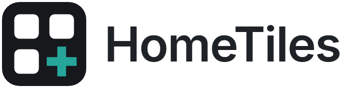
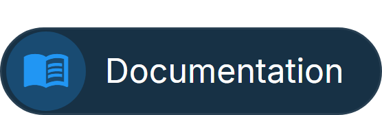
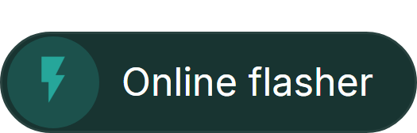
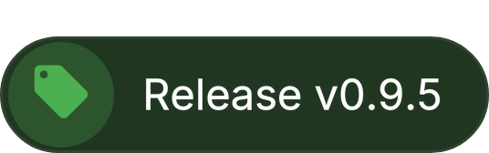
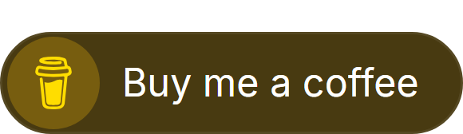
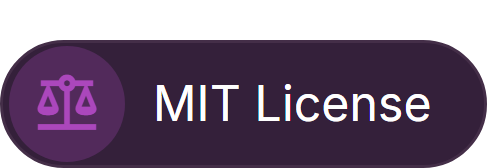

<picture>
  <source media="(prefers-color-scheme: dark)" srcset="docs/images/readme-brand-dark.png">
  
</picture>

Touch dashboards for Home Assistant on ESP32 displays. 
Lights, climate, sensors, energy, weather, cameras and more on a 4 to 10.1 inch touch screen.

<picture>
  <source media="(prefers-color-scheme: dark)" srcset="docs/images/readme-hero-v090-dark.png">
  
</picture>

## Screenshots

### Popups

### Tiles

### Web Admin

Build the dashboard in the browser; the Web Admin preview matches the display.

## New in v0.9.0

 
<picture>
  <source media="(prefers-color-scheme: dark)" srcset="docs/images/readme-caption-v09-row1-dark.svg">
  
</picture>

- **[Direct link to Home Assistant](https://galusperes.github.io/installer/#set-up-the-display):** press Pair on the display and add it in Home Assistant. No MQTT broker needed; existing MQTT setups keep working.
- **[Head bar and pages](https://galusperes.github.io/device-ui/#head-bar-and-pages):** fewer, larger tiles under a head with title, time and gear, up to five folders as pages beside Home, and an [upright layout](https://galusperes.github.io/device-ui/#layouts) for ESP32-P4 displays.
- **[Light theme](https://galusperes.github.io/device-ui/#light-theme):** Dark, Light or Automatic, on the display and in the Web Admin.
- **[New Settings](https://galusperes.github.io/device-ui/#settings):** on the display, with a first-start setup in four steps.
- **[Entity picker](https://galusperes.github.io/web-admin/#creating-a-tile):** searches every entity like Home Assistant, with Recent and Favorites on top.
- **[Clock](https://galusperes.github.io/tiles/#clock) and [Camera](https://galusperes.github.io/tiles/#camera) tiles:** analog and wall clocks, camera tiles that show the picture, and cameras in full screen.

## Updating from v0.8.0

1. Update HomeTiles Bridge to v0.9.0 and [export your dashboard](https://galusperes.github.io/web-admin/#import-export), then update the display.
2. **No MQTT broker needed:** on the display, tap **Pair** under **Settings → System → Security**. Home Assistant shows **Connect the panel**; select **Submit** and compare the number. [More](https://galusperes.github.io/advanced-setup/#moving-from-mqtt-to-the-direct-link)
3. **Every entity in the picker:** on the display, tap **Allow** next to **Web Admin password** under **Settings → System → Security**, then set the password in the Web Admin under **Settings → System** within two minutes. [More](https://galusperes.github.io/advanced-setup/#choosing-entities)
4. **New layout:** your tiles stay in the classic layout. In the Web Admin, open **Global → Change layout**, place the tiles for the head bar layout and select **Switch**. [More](https://galusperes.github.io/web-admin/#layouts)

[All changes](docs/releases/v0.9.0.md)

## Get started

You need a compatible display, Home Assistant and [HomeTiles Bridge](https://github.com/GalusPeres/HomeTiles-Bridge).

1. Find your exact model in the [device list](https://galusperes.github.io/#device-support).
2. Follow the [installation](https://galusperes.github.io/installer/): flash the display in the browser, install the Bridge, pair the display and add your tiles.

## Help

[Firmware updates](https://galusperes.github.io/updating/) · [Troubleshooting](https://galusperes.github.io/faq/) · [Report a problem](https://github.com/GalusPeres/HomeTiles/issues) · [Contribute](CONTRIBUTING.md) · [Architecture](ARCHITECTURE.md)

HomeTiles is free and open source under the [MIT License](LICENSE).
