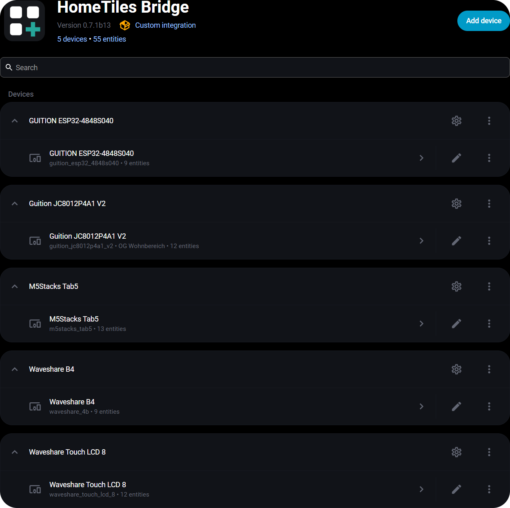

# Bridge Integration

The [HomeTiles Bridge](https://github.com/GalusPeres/HomeTiles-Bridge) connects your displays to Home Assistant: directly over an encrypted link, or over an MQTT broker. It shares entity data and sends tile actions back to Home Assistant, with each display listed as its own device.

<figure class="ht-screenshot">

<figcaption>Displays in the HomeTiles Bridge integration</figcaption>
</figure>

<a id="requirements"></a>

## Installation

You need Home Assistant 2025.11 or newer and HomeTiles Bridge v0.9.2 for all documented features with firmware v0.9.3. The direct link needs no MQTT broker. Follow the [Installation](installer.md#install-the-bridge) to install the Bridge and pair your first display.

<a id="via-hacs-recommended"></a>
<a id="manual"></a>
<a id="adding-a-panel"></a>

HACS provides Bridge updates. After an update, restart Home Assistant. For additional displays, follow [Multiple displays](advanced-setup.md#multiple-displays).

## Configuration

Open **Settings → Devices & Services → HomeTiles Bridge → Configure**.

### Panel Settings

| Field | Setting |
| --- | --- |
| Base topic | The display's topic name. Pairing sets it; over MQTT it must match **Device topic base** in the display's MQTT settings. Each display needs a unique value. |
| HA prefix | Default: `ha/statestream`. Use the same value on the Bridge and all displays. |
| Device name / manufacturer / model | Optional details shown in Home Assistant. |

### Entity Configuration { data-toc-label="Entities" }

A paired display with a [Web Admin password](web-admin.md#web-admin-password) does not need these lists: its entity picker finds every entity in Home Assistant, and the display tells the Bridge which entities its tiles use. Displays without a password, and displays on MQTT, offer the entities selected here.

Select the sensors, binary sensors, numbers, selects, date/time entities, weather, lights, switchable entities, covers, fans, locks, alarm panels, climate entities, media players, cameras, images, and scenes/scripts/buttons you want to use. Then assign them to tiles in the [Web Admin](web-admin.md).

Selections are shared across all displays. Action aliases are generated automatically and remain stable when selections are reordered; custom aliases use one `alias=entity_id` per line.

**Switches / switchable entities** accepts `switch`, `input_boolean`, `automation`, `fan`, `humidifier`, `remote`, and `siren`. They use the existing Switch tile and its on/off popup; lights retain brightness/color controls. Automations are enabled/disabled. Fan and Siren require HA support for both on and off.

**Scenes / Scripts / Buttons** accepts `scene`, `script`, `button`, and `input_button`. Assign these to the [Button tile](tiles.md#button) (called Scene before v0.9.2): a tap activates the scene, starts the script without parameters, or presses the button once. See the [compatibility table](tiles.md#switch) for exact behavior and limits. Use updated firmware for the complete availability handling and translated editor labels.

Older display configurations, entity selections, aliases, and MQTT topic names remain valid. Commands must target selected entities; retained switch/action commands are ignored on reconnect.

**Numbers** accepts `number` and `input_number`; **Selects** accepts `select` and `input_select`; **Date/Time** accepts `time`, `date`, `datetime`, and `input_datetime`. Use their dedicated [editable tile types](tiles.md#number). State, writable limits, options, availability, and history come from Home Assistant. Recorder exclusions also apply to these history views.

**Fans**, **Locks**, and **Alarm panels** feed the [Fan](tiles.md#fan), [Lock](tiles.md#lock), and [Alarm Panel](tiles.md#alarm-panel) tiles (Bridge v0.8.0). Locks and alarm panels can only be operated from a [paired](#encrypted-commands) display with a Web Admin password. **Codes for locks and alarm panels** lets the Bridge check the codes of devices that ignore a wrong code; **Allow opening without a code** is only for devices without their own code. Fans also remain selectable as switchable entities.

Bridge v0.9.0 remains compatible with older firmware and existing configurations. New features require the corresponding firmware; no reset or re-pairing is needed for a normal update.

## Control the Displayed View

Each compatible display exposes a **View** Select entity (**Ansicht** in German) on its existing Home Assistant device, next to the display controls. It offers **Home**, configured folders including nested folders, and configured tiles with supported popups.

Choosing an option opens that target using the existing display navigation and popup. Manual navigation and closing a popup report the actual view back to HA. Opening another popup closes the previous one and releases its resources, including a camera stream. Folder PIN protection remains in effect.

Options contain the folder path and a stable target suffix, so identical names remain distinguishable. Renaming or moving a tile updates its label; deleting it removes the option. Titles with line breaks remain two lines on the display but become one line in this list. Update an automation's option text if you rename or move its target.

For example, use these actions after your doorbell trigger. Replace the Select entity and camera option with the exact values shown by your own display:

```yaml
actions:
  - action: select.select_option
    target:
      entity_id: select.hall_display_view
    data:
      option: "Home / Entrance camera [t:12]"
  - delay: "00:00:20"
  - action: select.select_option
    target:
      entity_id: select.hall_display_view
    data:
      option: "Home"
```

Commands to offline displays or missing targets are rejected. Status updates do not navigate, and old commands are not replayed after a restart or MQTT reconnection. Camera targets are available only on ESP32-P4.

### Energy Dashboard

Enable the electricity, gas, or water categories you need. Each requires the corresponding data in Home Assistant's [Energy Dashboard](https://my.home-assistant.io/redirect/energy/). These selections are also shared across displays.

### Pairing and Encryption { #encrypted-commands data-toc-label="Pairing" }

Pairing connects a display to the Bridge over the direct link. Every message between them is encrypted and signed, commands as well as states, and each command runs at most once. Camera stream tokens travel encrypted too.

1. On the display, tap **Pair** under **Settings → System → Security** (or in the first-start setup).
2. Home Assistant shows **Panel found** under **Settings → Devices & services → Discovered**; a display that is already set up over MQTT shows **Connect the panel**. Select **Add** or **Submit**.
3. The display and Home Assistant show the same six-digit number. Confirm only if both numbers match, in Home Assistant and on the display.

The [Installation](installer.md#set-up-the-display) shows each step. To switch encryption off, unpair on the display or use **Security** in the Bridge options; the other side follows, and the display then counts as a new display.

Displays paired over MQTT with firmware v0.8.0 keep their encrypted commands until they are paired again; pairing moves them to the direct link. Protocol details: [bridge-link.md](https://github.com/GalusPeres/HomeTiles/blob/main/docs-dev/bridge-link.md) and [command-encryption.md](https://github.com/GalusPeres/HomeTiles/blob/main/docs-dev/command-encryption.md).

## Local Hardware Entities { data-toc-label="Local I/O" }

Configure GPIO switches, onboard relays, and DS18B20 inputs on the display's [I/O tab](hardware-io.md). The Bridge adds them to that display's Home Assistant device automatically; they do not belong in the shared entity selection.

Saving an assignment announces it again. Deleting it makes the old Home Assistant entity unavailable. Names you changed manually in Home Assistant are preserved.

### Retired Automatic Sensors

Bridge migration removes obsolete integration-owned battery and external-temperature entries only when they do not match the display's reported capabilities. It also cleans the corresponding shared selections and configuration, so ordinary restart or re-pairing does not recreate them. Devices without implemented battery measurement no longer advertise a battery sensor.

Configured local I/O and supported sensors are preserved, as are explicitly selected user entities. This cleanup does not delete arbitrary entities because their name contains `Tab5`.

## Experimental Camera Transport { data-toc-label="Camera connection" }

Camera tiles are available on ESP32-P4. Allow the display to reach the Home Assistant host on TCP ports `8124`–`8131`. The Bridge sends display-sized JPEG frames directly over the local network; MQTT handles camera control.

Each open display uses its own stream. Video conversion uses Home Assistant CPU time, while snapshot cameras are limited by their source refresh rate. See [Camera troubleshooting](faq.md#the-camera-tile-asks-for-a-newer-bridge-or-never-shows-video) if no video appears.

## Built-in Camera

Displays with a camera can share it with Home Assistant. This needs HomeTiles v0.7.0 and Bridge v0.7.0 or newer.

| Display | Camera |
| --- | --- |
| Guition JC8012P4A1 V2 and V1 | Built-in OV02C10 |
| Guition JC1060P470C V2, JC4880P443 | Optional OV02C10 module on the CSI connector |
| Waveshare ESP32-P4 7-inch, 8-inch, 10.1-inch | Built-in OV5647 front camera |
| Waveshare ESP32-P4 7B, 4.3-inch, 5-inch, 4B | Optional OV5647 module on the CSI connector |
| M5Stack Tab5 | Built-in SC2356 |

Tested on the Guition JC8012P4A1 V2, Waveshare 8-inch, and M5Stack Tab5. On the other displays, use **Rotation**, **Mirror image**, or **Swap red and blue** under [Advanced](web-admin.md#built-in-camera) if the image appears turned or its colors are swapped.

1. In the Web Admin, open **Settings → Built-in camera** and enable **Allow Home Assistant to use the built-in camera**, then press **Save**.
2. The Bridge adds a **Camera** entity to the display's Home Assistant device, plus a **Camera** switch that pauses it.
3. Open the camera in Home Assistant, or show it on another display with a [Camera tile](tiles.md#camera).

The display captures images only while Home Assistant asks for them. Opening the camera starts a live stream that uses the same TCP ports `8124`–`8131` as camera tiles; it stops a few seconds after the last viewer closes. While the camera is in use, the display shows the [camera indicator](device-ui.md#built-in-camera-indicator). Tapping its pill ends the current stream.

Disabling the setting removes the entity. The paused switch keeps the entity but sends no images. A display cannot show its own camera in its own camera popup.

## Voice Assistant (early version) { #voice-assistant data-toc-label="Voice assistant" }

ESP32-P4 displays with a speaker and microphone can play audio from Home Assistant and work as an Assist voice satellite. This needs HomeTiles v0.9.2 and Bridge v0.9.2. It is an early version: the display has no microphone button and no audio settings yet; everything is set in Home Assistant.

It runs on the Waveshare ESP32-P4 4B, 4.3-inch, 7-inch, 7B, 8-inch and 10.1-inch, the Guition JC8012P4A1 V1, V2 and V3, JC1060P470C V2 and JC4880P443, and the M5Stack Tab5. Displays with only a speaker connector need a speaker fitted. Tested on the Guition JC8012P4A1 V2, Waveshare 4B and 8-inch, and M5Stack Tab5. The ESP32-S3 displays have no voice support.

The Bridge adds these entities to the display's Home Assistant device while the display announces its speaker or microphone:

| Entity | Use |
| --- | --- |
| **Speaker** | Media player: plays audio and announcements on the display and sets its volume. |
| **Assist** | Assist satellite: Home Assistant's voice pipeline listens through the display's microphone, and the answer plays on its speaker. |
| **Start Assist** button | Starts a voice request without a wake word. |
| **Listening** | The display listens for its wake word by itself. Off on a new display. |
| **Wake word** | Okay Nabu, Hey Jarvis or Alexa. Kept while Listening is off. |
| **Assistant** | The Assist pipeline the display uses. |
| **Finished speaking detection** | How quickly a request ends after you stop speaking. |
| **Microphone** | Off on a new display. Turning it on from Home Assistant needs a [paired](#encrypted-commands) display. |

It works on the direct link and over MQTT.

## MQTT Topics Reference { data-toc-label="MQTT reference" }

Entity states use `<HA prefix>/<entity>/...`. The Bridge publishes them itself; Home Assistant's MQTT Statestream integration is not required. On the direct link the same topics travel over the link instead of a broker.

??? info "Topic reference for debugging"
    `{id}` is the panel device ID; `<base>` is its unique base topic.

    | Topic | Direction | Purpose |
    | --- | --- | --- |
    | `<base>/stat/connected` | Display → HA | Connection status |
    | `<base>/view/catalog/*` | Display → HA | Available navigation targets |
    | `<base>/stat/view` | Display → HA | Confirmed current view |
    | `<base>/cmnd/view` | HA → Display | Navigate to a current target |
    | `<base>/cmnd/value` | Display → HA | Validated Number, Select, or Date/Time edit |
    | `<base>/stat/value` | HA → Display | Editable command result |
    | `tab5_lvgl/config/{id}/bridge` | Display → HA | Device and local I/O announcement |
    | `tab5_lvgl/config/{id}/bridge/apply` | HA → Display | Configuration |
    | `tab5_lvgl/config/{id}/bridge/icons` | HA → Display | Icon updates |
    | `tab5_lvgl/config/{id}/history/*` | Both | Sensor history |
    | `tab5_lvgl/config/{id}/weather/*` | Both | Weather forecasts |
    | `tab5_lvgl/config/{id}/energy/*` | Both | Energy data |
    | `<base>/cmnd/light` | Display → HA | Light controls |
    | `<base>/cmnd/switch` | Display → HA | Compatible on/off controls |
    | `<base>/cmnd/media` | Display → HA | Media controls |
    | `<base>/cmnd/climate` | Display → HA | Climate controls |
    | `<base>/cmnd/cover` | Display → HA | Cover controls |
    | `<base>/cmnd/scene` | Display → HA | Scene/script activation or button press |
    | `<base>/cmnd/camera` | Display → HA | Open/close a camera session |
    | `<base>/stat/camera` | HA → Display | Camera connection and status |
    | `<base>/cmnd/local_camera` | HA → Display | Still image or live stream request for the built-in camera |
    | `<base>/stat/local_camera` | Display → HA | Built-in camera status (`ready`, `disabled`, `error`) |
    | `<base>/cmnd/display_brightness` | HA → Display | Display brightness (1–100%) |
    | `<base>/stat/display_brightness` | Display → HA | Current display brightness |
    | `<base>/cmnd/screensaver_brightness` | HA → Display | Screensaver brightness (1–100%) |
    | `<base>/stat/screensaver_brightness` | Display → HA | Current screensaver brightness |
    | `<base>/cmnd/io/{channel_id}` | HA → Display | Local Switch command (`ON` / `OFF`) |
    | `<base>/stat/io/{channel_id}` | Display → HA | Local Switch or temperature state |
