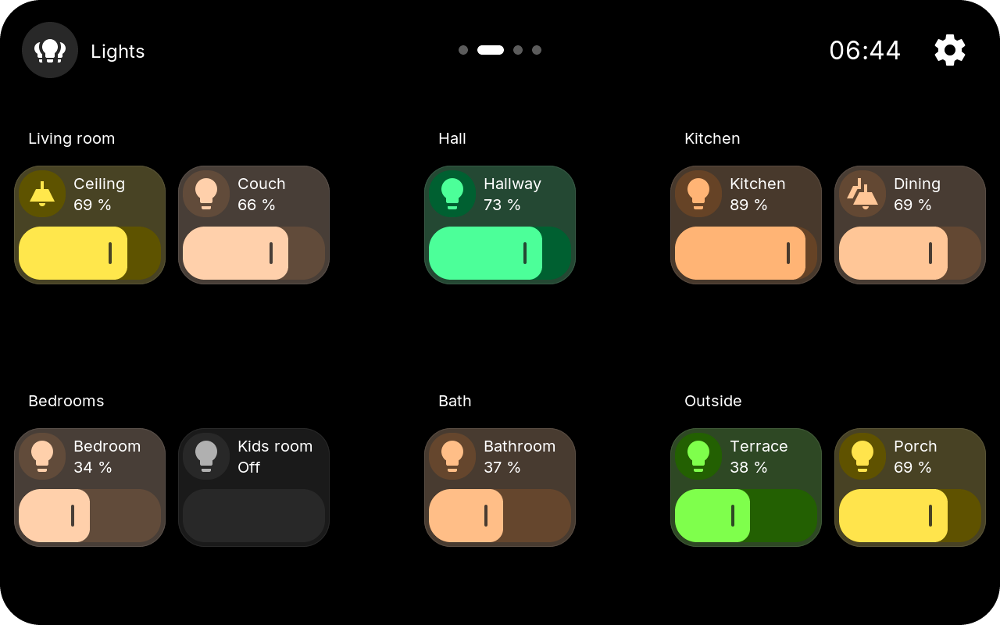
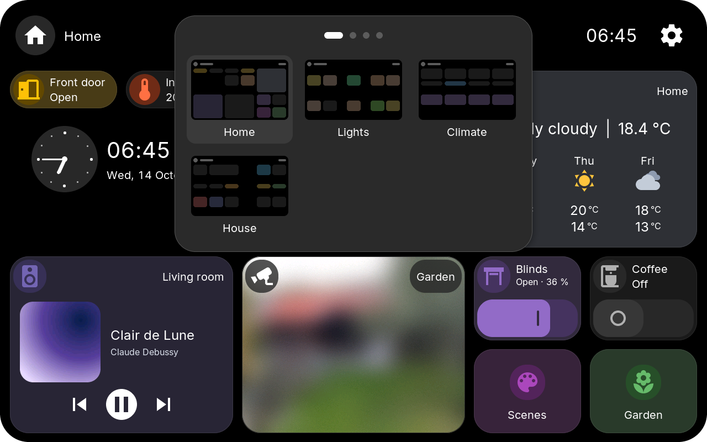
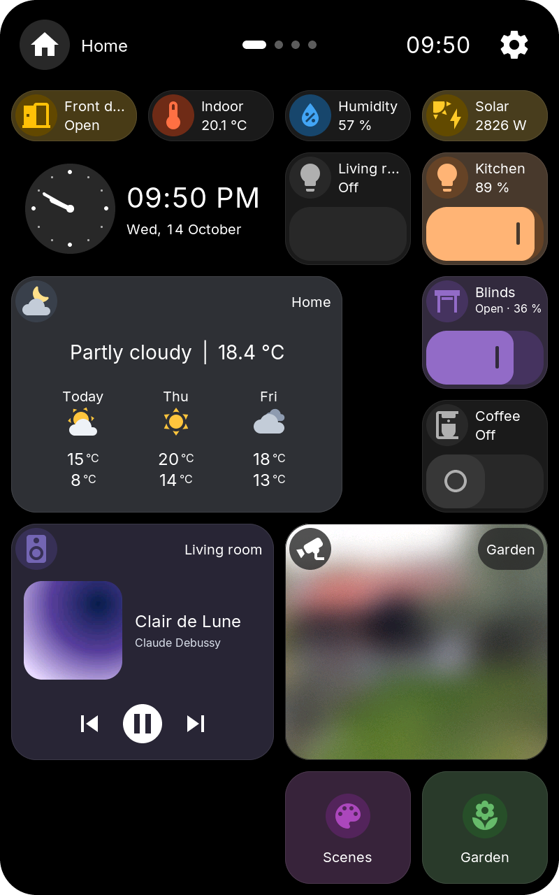
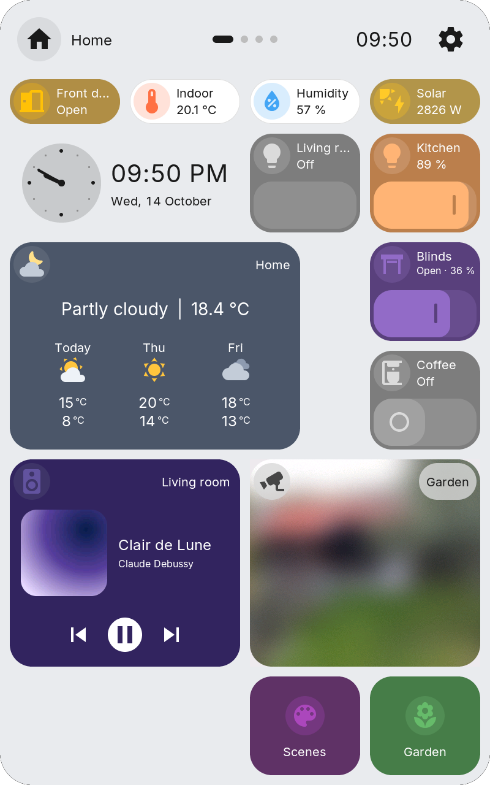
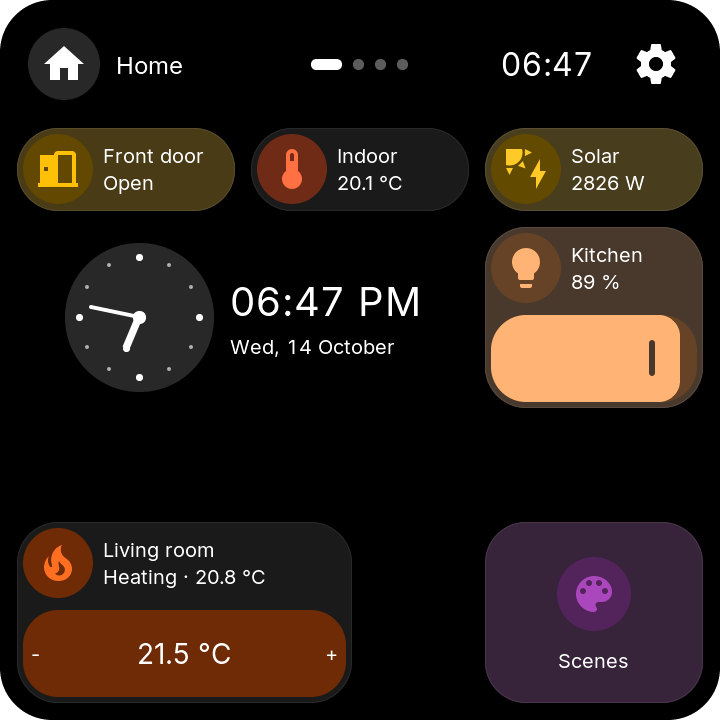
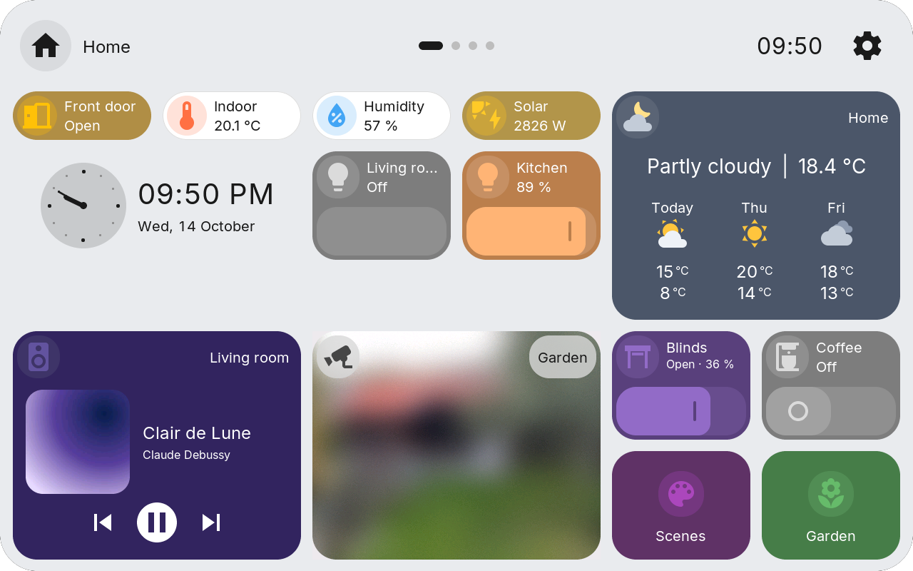
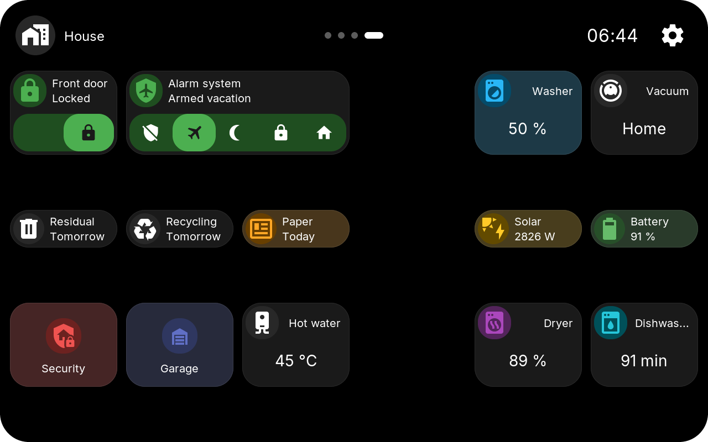
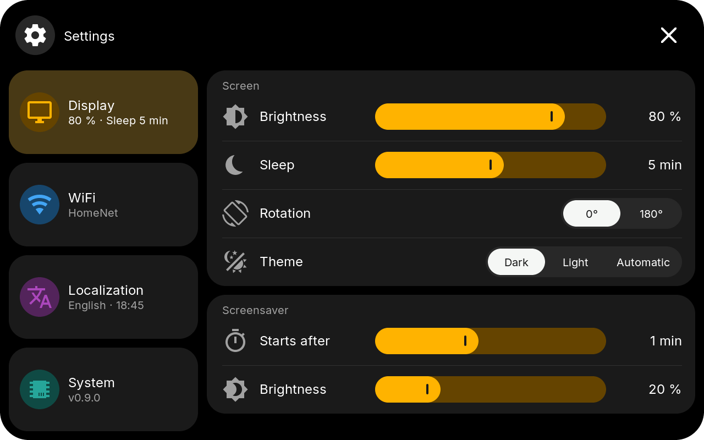
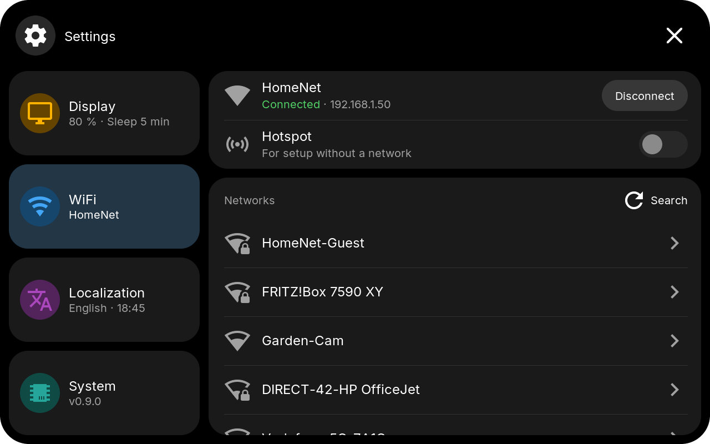
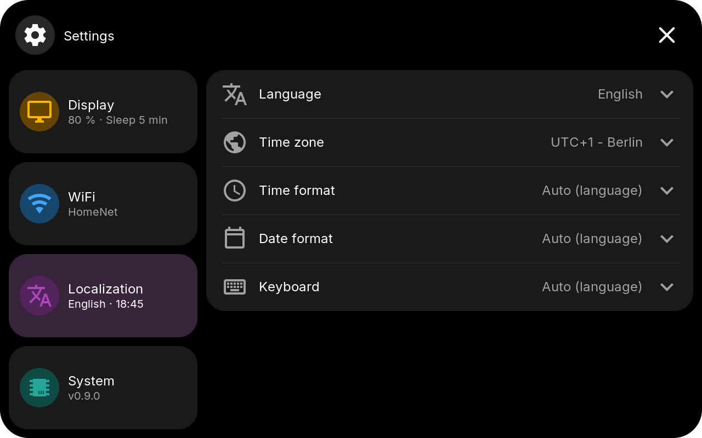

# On-Device UI

Tap tiles to control devices, open folders, or view details. Arrange the tiles in the [Web Admin](web-admin.md).

<figure class="ht-screenshot">

<figcaption>Home in the head bar layout</figcaption>
</figure>

Every icon sits on a round circle, and a tile can be filled with its icon's color. Half-height tiles show their title and value next to the icon. [Rules](web-admin.md#colors-and-rules) can color a tile by the state of an entity. Every tile type and its popup is shown under [Tile Types](tiles.md).

## Head Bar And Pages { #head-bar-and-pages data-toc-label="Head bar and pages" }

The head shows Home's icon and title on the left, the page dots in the middle, and the time and the gear for Settings on the right. In a folder the head shows the folder's name, and the **X** goes back.

Up to five folders can be **pages** beside Home; choose them in the [Web Admin](web-admin.md#pages). The dots show which page is open:

- **Swipe** sideways anywhere on a page to turn it. Sliders and bars keep their own touch. On Home, a swipe from left to right opens the screensaver; over the screensaver, a swipe from right to left goes back to Home.
- **Tap beside the dots** to turn one page to that side.
- **Tap the dots** to open the overview with a picture of every page, then tap a picture. Or hold the dots, slide onto a picture and let go. The overview closes after 10 seconds.

<figure class="ht-screenshot">

<figcaption>A page: lights by room</figcaption>
</figure>
<figure class="ht-screenshot">

<figcaption>The overview of all pages</figcaption>
</figure>

Title, icon, time, gear and overview can be changed or switched off in the Web Admin's [Head bar](web-admin.md#head-bar) tab.

## Layouts

Every display has three layouts, each with its own places for the tiles:

| Layout | Look |
| --- | --- |
| **Head bar landscape** | Fewer, larger tiles under the head bar, with pages. New displays start with it. |
| **Head bar portrait** | The same for ESP32-P4 displays mounted upright. |
| **Classic** | The grid of earlier versions, with Settings and Back tiles and no head. |

Switch the layout in the Web Admin's [layout window](web-admin.md#layouts); the display restarts with it. A new display that can stand upright asks for landscape or upright in its first-start setup.

<figure class="ht-screenshot">

<figcaption>Upright</figcaption>
</figure>
<figure class="ht-screenshot">

<figcaption>Upright, light theme</figcaption>
</figure>
<figure class="ht-screenshot">

<figcaption>4-inch square display</figcaption>
</figure>

## Light Theme

Choose **Dark**, **Light** or **Automatic** under **Settings → Display → Theme** or in the Web Admin. **Automatic** is light by day and dark at night. Filled tiles keep their color in both themes.

<figure class="ht-screenshot">

<figcaption>The light theme</figcaption>
</figure>

## Edge Swipes

Swipe inward from a screen edge for a quick action. Each edge can open **Settings**, go **Home**, go **Back**, or start the **screensaver**. New displays open Settings from the top edge and go Home from the bottom edge. Change the edges in the Web Admin's [Global](web-admin.md#global-settings) tab under **Edge swipes**.

## Folders

A folder tile opens its own page; its head shows the folder's name and the **X** returns. A protected folder asks for its PIN first; see [Folder](tiles.md#folder).

<figure class="ht-screenshot">

<figcaption>A page with the folders Security and Garage</figcaption>
</figure>

## Popups

For tiles with detail controls, choose a tap or long press as the popup trigger in the Web Admin. The popup's head shows the tile's icon and circle, and most popups take the tile's color.

History popups have **7D** and **24H** views (Energy: **7D** and **Today**); the previous data stays visible until the new period arrives. To read an earlier value, touch a graph and move your finger along it, or tap an Energy bar. The time and value appear above the graph, and the marker stays where you let go.

| Tile | Popup |
| --- | --- |
| [Sensor](tiles.md#sensor), [Binary Sensor](tiles.md#binary-sensor) | History graph or state timeline with Activity |
| [Number](tiles.md#number), [Select](tiles.md#select), [Date/Time](tiles.md#datetime) | Control above the history |
| [Energy](tiles.md#energy) | Hourly and daily bars |
| [Switch](tiles.md#switch) | Brightness, color, and color temperature for lights; on/off otherwise |
| [Cover](tiles.md#cover) | Position and tilt |
| [Weather](tiles.md#weather), [Media](tiles.md#media), [Climate](tiles.md#climate) | Forecast, playback, temperature and modes |
| [Fan](tiles.md#fan), [Lock](tiles.md#lock), [Alarm Panel](tiles.md#alarm-panel) | Speed and presets, lock and open, arming modes |
| [Camera](tiles.md#camera) | Live video, also full screen |
| [Calendar](tiles.md#calendar) | Month with the day's events, or the coming weeks as a list |

Home Assistant can also open a folder or popup using the display's [View Select entity](bridge.md#control-the-displayed-view).

## Built-in Camera Indicator { data-toc-label="Camera indicator" }

While Home Assistant uses the display's own [built-in camera](bridge.md#built-in-camera), a red line runs along the top edge. In the head bar layouts a camera circle with a red icon appears in the head; in the classic layout a **Camera active** pill appears below the line. Tap the circle or the pill to end the live stream; the camera stays available for the next request. Both parts can be switched off in the [Web Admin](web-admin.md#built-in-camera).

## Settings

The gear in the head opens Settings. If Settings is PIN-protected, enter the PIN first. Settings can also open by an [edge swipe](#edge-swipes); the factory PIN **466384537** also unlocks protected folders, see [Settings access](web-admin.md#settings-tile-and-access).

Settings has four pages; the **X** closes it.

### Display

Brightness, sleep timeout, rotation, and the theme; for the screensaver its start time and brightness. **Never** switches the corresponding timeout off. Rotation offers 0°, 90°, 180° and 270° on displays that turn in quarter turns, 0° and 180° on the others. Tap a **Clock** tile to open the [screensaver](screensaver.md) at once.

On displays with a speaker the page is called **Display & Sound** and adds a **Sound** group: the speaker volume and, where there is a microphone, its switch. Home Assistant sets the same values.

<figure class="ht-screenshot">

<figcaption>Display</figcaption>
</figure>

### WiFi

The connected network with its address and **Disconnect**, the **Hotspot** for a setup without a network, and the networks around. **Search** looks again; tap a network to join it with its password. Displays with Ethernet can switch to it here.

<figure class="ht-screenshot">

<figcaption>WiFi</figcaption>
</figure>

### Localization

Choose English, German, French, Polish, Czech, Slovak, Spanish, or Russian, the time zone, the time and date formats, and the keyboard layout. Tile titles support Cyrillic characters in every text size.

The keyboard follows the language when set to **Auto**: German, Czech, and Slovak use QWERTZ, French uses AZERTY, Russian uses ЙЦУКЕН, and English, Polish, and Spanish use QWERTY. The key beside **?123** shows the language's own letters first, for example ä, ö, ü, and ß in German, á, č, ď, é, ě, í, ň, ó, ř, š, ť, ú, ů, ý, and ž in Czech, or ñ, á, é, í, ó, ú, ü, ¿, and ¡ in Spanish, followed by other common European letters; **ABC** returns to the letters. Holding a letter offers its accented forms, the language's own first. On the Russian keyboard the same key switches to QWERTY for passwords (**ABC**) and back (**АБВ**), and holding е or ь gives ё or ъ.

<figure class="ht-screenshot">

<figcaption>Localization</figcaption>
</figure>

### System

<figure class="ht-screenshot">

<figcaption>System</figcaption>
</figure>

- **Firmware:** the version and the device; **Update** looks for a new release, see [Firmware Updates](updating.md).
- **Connection:** **Home Assistant** with a check while the display is connected, and the way: **Direct · Bridge** with the Bridge's address, or **MQTT · Broker**.
- **Security:** **Pairing** with Home Assistant ([Installation](installer.md#set-up-the-display)): **Pair** while unpaired, **Unpair** inside **Paired**. **Web Admin password**: **Allow** lets you set the first password in the Web Admin within two minutes; while a password is set, you can remove a forgotten one here. Both ask before they act.
- **Setup** opens the first-start setup again, **Restart** restarts the display, **GitHub** shows a QR code for the project.
