# Tile Types

Create and configure tiles in the [Web Admin](web-admin.md#creating-a-tile) and choose their entity in the entity picker.

**Home Assistant tiles** show entity data or control your devices. **Local tiles** provide clocks, text, folders, animations, and spacing.

All tiles share title, icon, color, size, and position settings. For types with a popup, choose whether a tap or long press opens it; the popup takes on the tile's icon, circle, and color. See [On-Device UI](device-ui.md#popups) for how popups behave.

Press **Enter** in the title field for a second line. The two lines share the same vertical center as a single-line title; text that does not fit ends in `...`. The display, popup header, and Web Admin preview use the same title.

**Sizes:** every tile resizes in half steps from 1×1. All tiles except Weather, Media, and Animation can also be half a cell high; they then show the title and state or value next to the icon, without a bar.

<figure class="ht-screenshot">
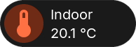
<figcaption>Sensor</figcaption>
</figure>
<figure class="ht-screenshot">

<figcaption>Switch</figcaption>
</figure>
<figure class="ht-screenshot">
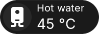
<figcaption>Number</figcaption>
</figure>

**Colors:** a tile's color always comes from its icon: the icon's own color, the color of a light, or the color you pick for the icon. **Fill** fills the tile with that color. [Rules](web-admin.md#colors-and-rules) color the icon by an entity's value or state, and a rule row with **Fill** fills the tile while it matches. Clock, Text and Animation tiles have their own color, and Clock and Text tiles can be **Transparent**.

## Home Assistant Tiles

These types show or control a Home Assistant entity.

### Sensor

Shows a numeric or text-valued `sensor.*` entity. Configure the unit, decimals, value size, and an optional gauge with a minimum and maximum.

<figure class="ht-screenshot">
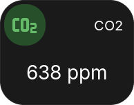
<figcaption>Icon color</figcaption>
</figure>
<figure class="ht-screenshot">
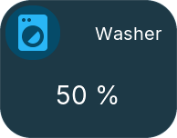
<figcaption>With Fill</figcaption>
</figure>

<figure class="ht-screenshot ht-popup">
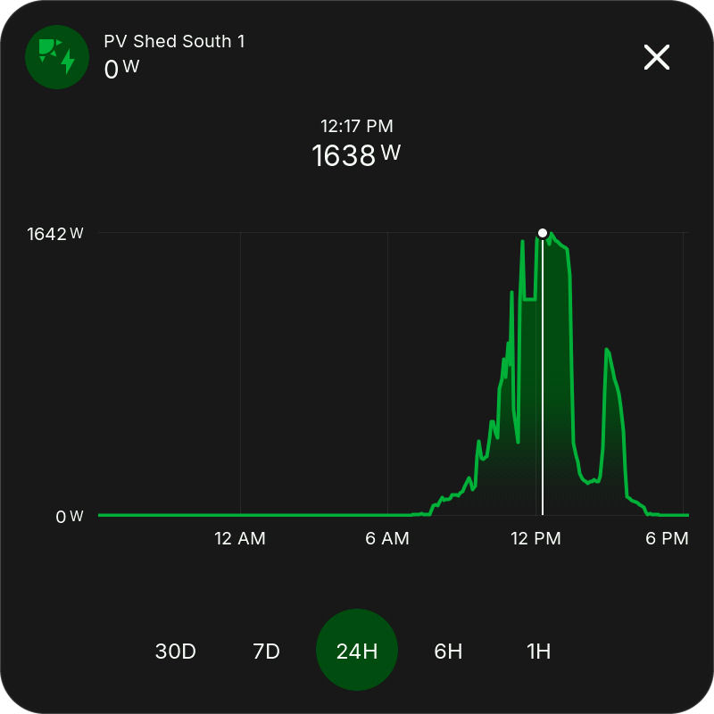
<figcaption>Popup, 24 hours</figcaption>
</figure>

**Popup:** the current value in the header and a **7D** or **24H** history: a graph for numbers, or a timeline and Activity list for text states. Touch the graph and move your finger to read an earlier value; the time and value appear above the graph, and the marker stays where you let go.

A local [DS18B20 input](hardware-io.md) can also supply the value without Home Assistant; local inputs have no Home Assistant history popup.

### Binary Sensor

Shows a `binary_sensor.*` entity with the matching state and icon, such as Open/Closed or Motion/Clear. Unknown and unavailable states are shown separately.

<figure class="ht-screenshot">
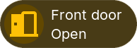
<figcaption>Tile</figcaption>
</figure>

<figure class="ht-screenshot ht-popup">
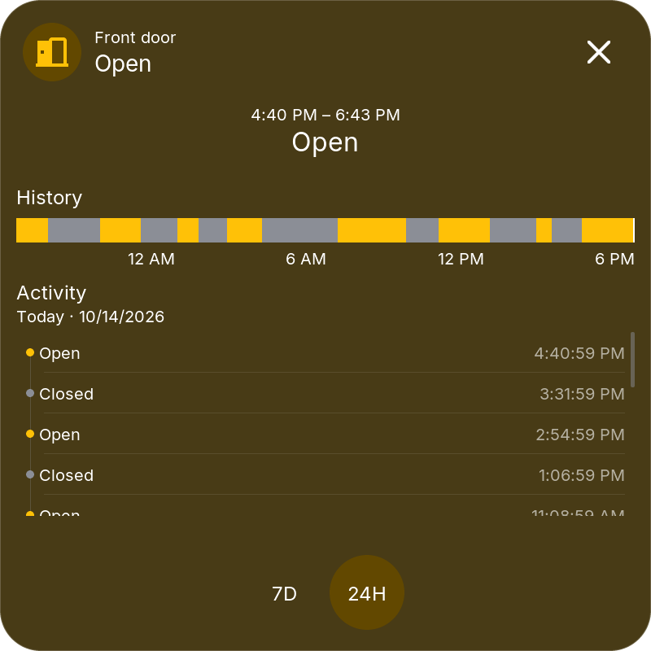
<figcaption>Popup</figcaption>
</figure>

**Popup:** a **7D** or **24H** state timeline and Activity list.

### Number

Changes a `number.*` or `input_number.*` entity. The tile shows its current value and unit; the popup uses the minimum, maximum, step, and input mode supplied by Home Assistant.

<figure class="ht-screenshot">
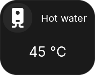
<figcaption>Tile</figcaption>
</figure>

<figure class="ht-screenshot ht-popup">
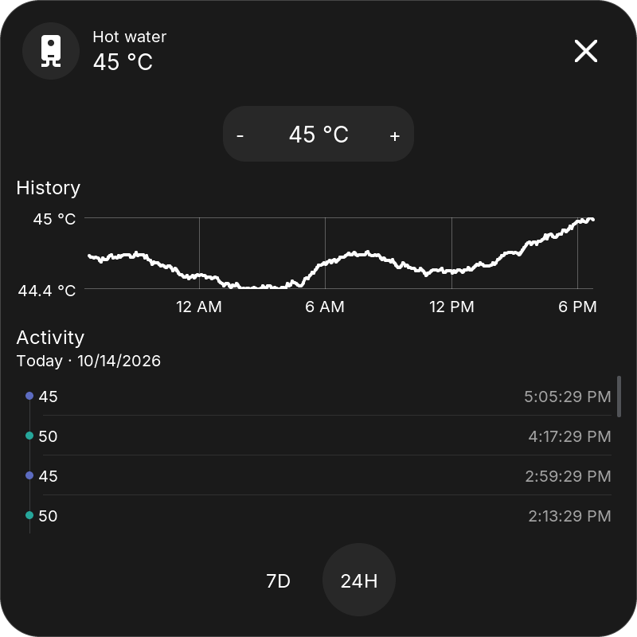
<figcaption>Popup</figcaption>
</figure>

- Slider values use a centered slider with the value above it. Release the slider to send the final value.
- Temperatures use **− / value / +**, like the Climate target control.
- Other box-mode values use a bounded roller or step buttons, depending on their range.

**Popup:** the control above a numeric history graph and Activity for **7D** or **24H**. History requires the entity to be recorded by Home Assistant.

### Select

Changes a `select.*` or `input_select.*` entity using its current Home Assistant options. The tile shows the selected value; the popup uses the same dropdown interaction as Settings.

<figure class="ht-screenshot">
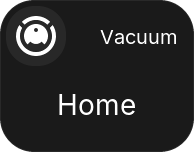
<figcaption>Tile</figcaption>
</figure>

<figure class="ht-screenshot ht-popup">
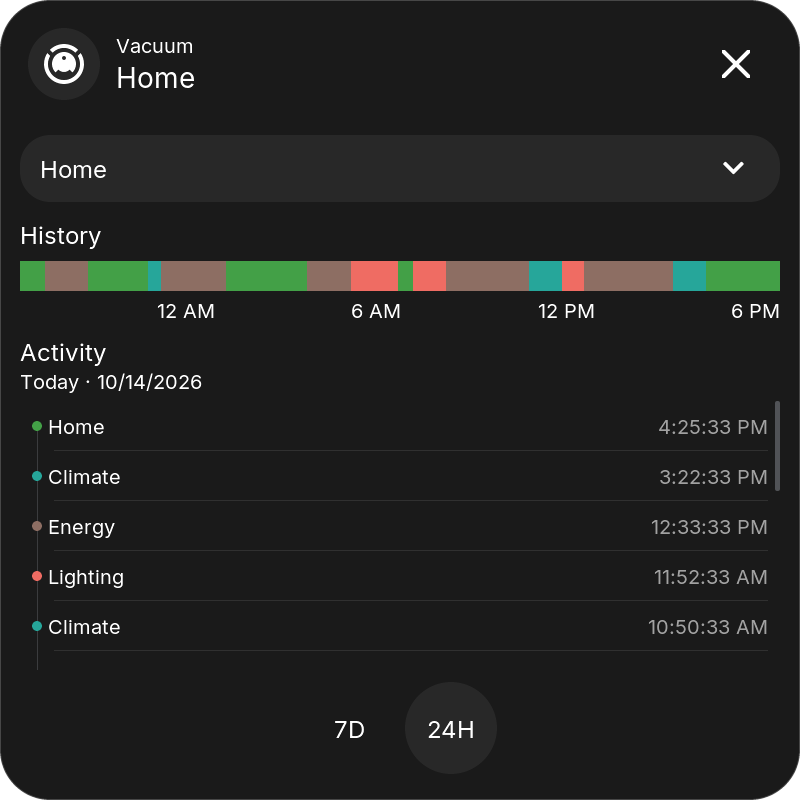
<figcaption>Popup</figcaption>
</figure>

**Popup:** the dropdown above a compact timeline and Activity for **7D** or **24H**. An unavailable entity or incomplete option list disables selection. To operate another display's view, choose that display's [View entity](bridge.md#control-the-displayed-view).

### Date/Time

Changes `time.*`, `date.*`, `datetime.*`, or `input_datetime.*` entities. Available controls follow whether the entity contains a time, a date, or both.

<figure class="ht-screenshot">
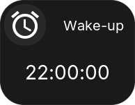
<figcaption>Tile</figcaption>
</figure>

<figure class="ht-screenshot ht-popup">
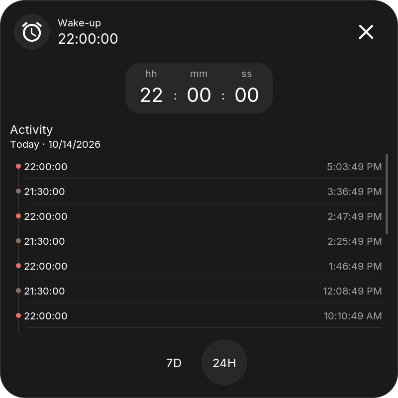
<figcaption>Popup</figcaption>
</figure>

Time uses a single visible row of large, swipeable **hh / mm / ss** values, with wraparound between 23 and 00 or 59 and 00. Date fields use step controls without a keyboard.

**Popup:** the controls above Activity for **7D** or **24H**. Home Assistant's time zone is used for date/time commands.

Slider edits are sent on release; step and time edits are grouped after a short pause, and the display keeps your edit while a slow device confirms it. Unavailable entities cannot be changed.

### Energy

Shows Home Assistant **Energy Dashboard** statistics for electricity, gas, water, or cost. Enable the matching [Bridge energy category](bridge.md#energy-dashboard). Configure the energy entity, unit, decimals, and value size.

<figure class="ht-screenshot">
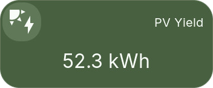
<figcaption>Tile</figcaption>
</figure>
<figure class="ht-screenshot">
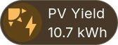
<figcaption>Half height</figcaption>
</figure>

<figure class="ht-screenshot ht-popup">
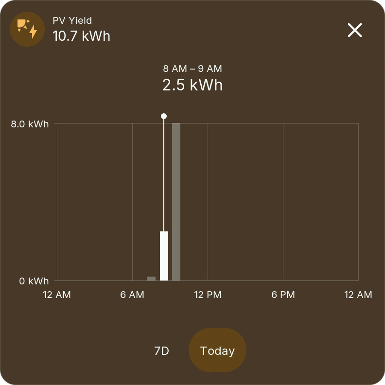
<figcaption>Popup, today</figcaption>
</figure>
<figure class="ht-screenshot ht-popup">
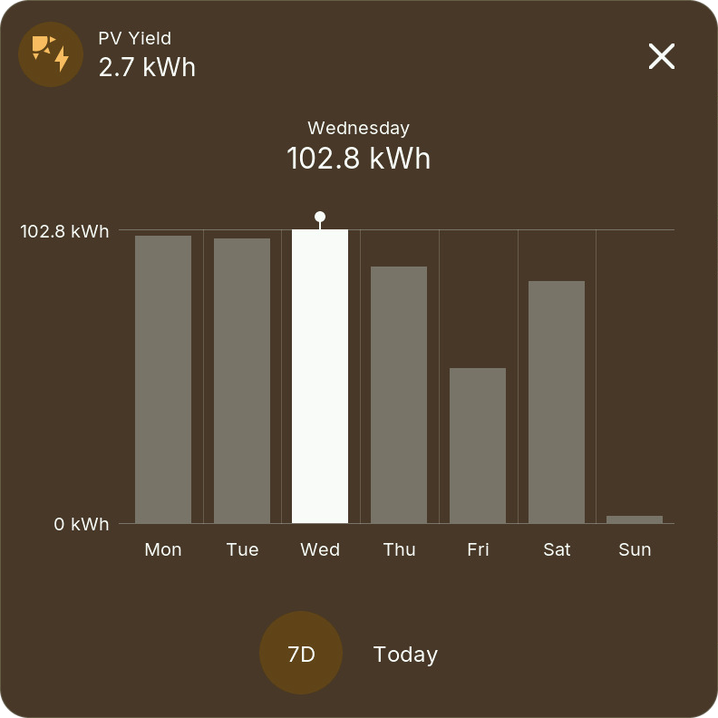
<figcaption>Popup, 7 days</figcaption>
</figure>

**Popup:** hourly bars for the day and daily bars for the week. Tap a bar to read its time and value; a dot marks the bar you read.

### Switch

Toggles a compatible entity and reflects its state. Choose the entity, **Layout**, and popup trigger.

| Layout | Tile |
| --- | --- |
| **Automatic** | A dimmer bar for lights that can dim, otherwise the switch bar. Default for new tiles. |
| **Dimmer** | A brightness bar across the tile: press or drag to set the level, like the popup's brightness slider. Lights without dimming get the switch bar. |
| **Switch** | An on/off bar with a thumb, like the popup's switch. |
| **Icon button** | No bar: tap the tile to toggle. |

The tile shows the state (`On`, `Off`, or the brightness) under its title. Half-height tiles show the state only; tap toggles, and the other gesture opens the popup. Commands while dragging are paced like Home Assistant, and the last level is always sent. A light fills its tile in its own color.

<figure class="ht-screenshot">
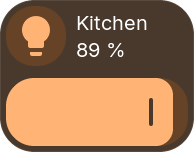
<figcaption>Dimmer</figcaption>
</figure>
<figure class="ht-screenshot">
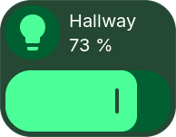
<figcaption>Dimmer, colored light</figcaption>
</figure>
<figure class="ht-screenshot">
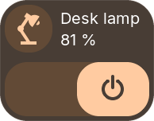
<figcaption>Switch</figcaption>
</figure>
<figure class="ht-screenshot">
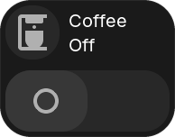
<figcaption>Switch, off</figcaption>
</figure>
<figure class="ht-screenshot">
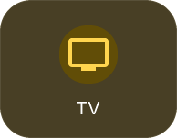
<figcaption>Icon button</figcaption>
</figure>

| Home Assistant domain | Tile action |
| --- | --- |
| `switch`, `light` | Turn on/off |
| `input_boolean` | Set a Toggle helper on/off |
| `automation` | Enable/disable the automation's triggers |
| `fan`, `humidifier`, `remote`, `siren` | Turn the entity on/off using its configured defaults |

Fan and Siren controls require both HA on/off feature flags. Missing, unavailable, or unsupported entities cannot be operated.

An [automation switch](https://www.home-assistant.io/docs/automation/services/) enables/disables the automation; it does not run its actions immediately. Turning it off follows HA's default behavior and stops running actions. For fan speed, presets, and direction use the [Fan](#fan) tile; humidity, remote commands/activities, and siren tones are outside this tile's on/off controls.

Local [outputs and relays](hardware-io.md) appear in the same selector and work without Home Assistant.

**Popup for lights:** brightness, color, and color temperature; only the controls the light supports appear. The bottom icons switch views, and the power button toggles the light.

<figure class="ht-screenshot ht-popup">
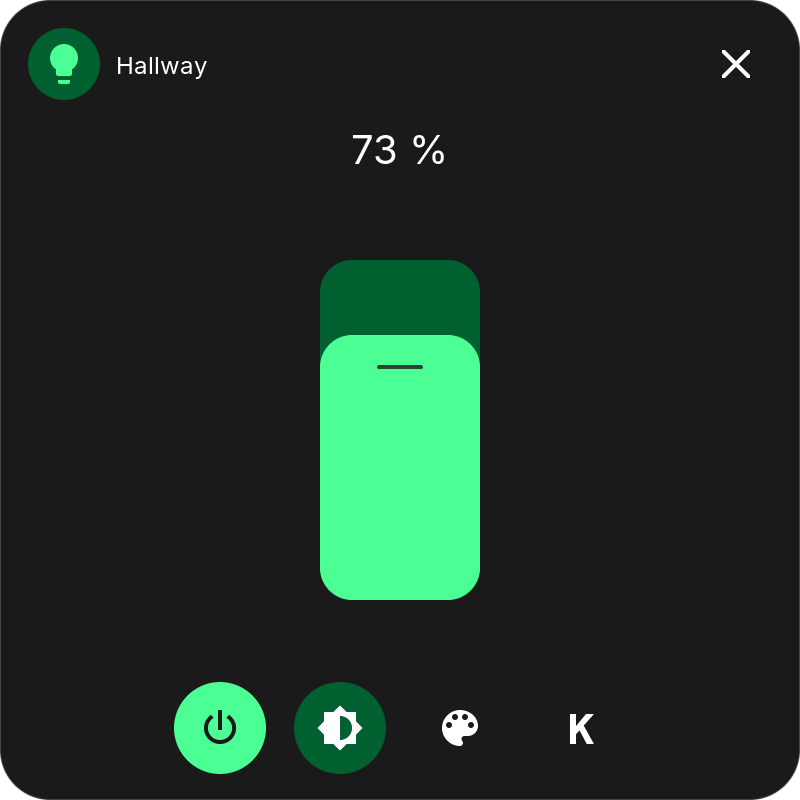
<figcaption>Brightness</figcaption>
</figure>
<figure class="ht-screenshot ht-popup">
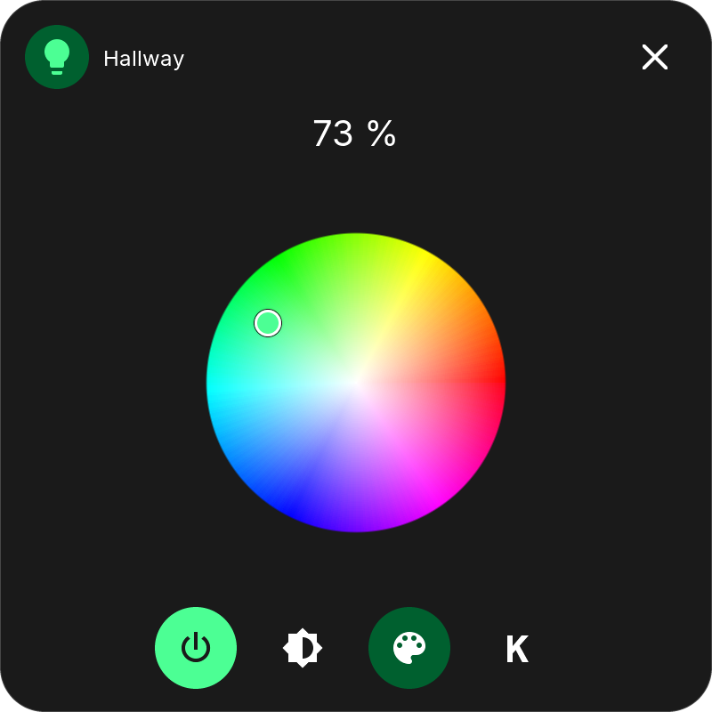
<figcaption>Color</figcaption>
</figure>
<figure class="ht-screenshot ht-popup">
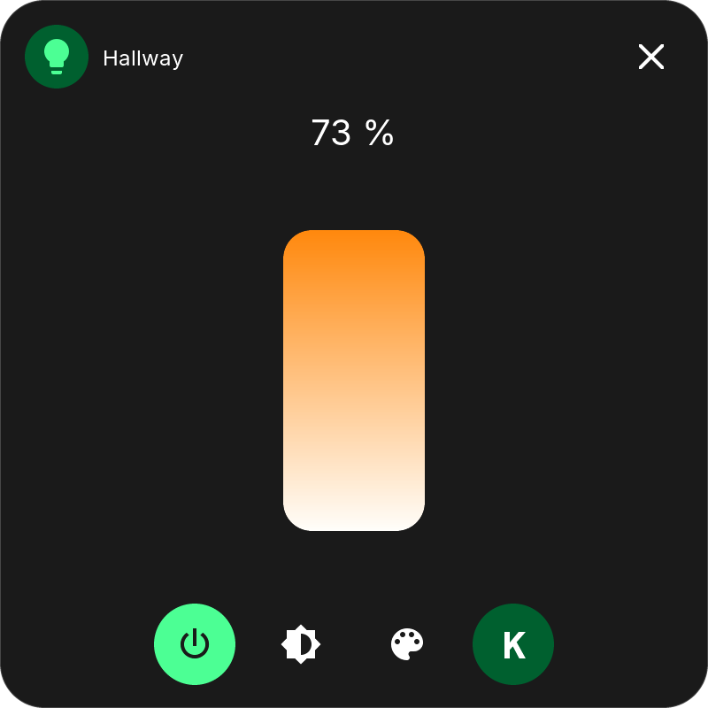
<figcaption>Color temperature</figcaption>
</figure>

**Popup for other compatible entities:** the on/off slider in the same popup.

### Cover

Controls a `cover` entity and shows its state and position when available.

<figure class="ht-screenshot">
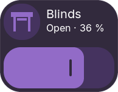
<figcaption>Tile</figcaption>
</figure>

<figure class="ht-screenshot ht-popup">
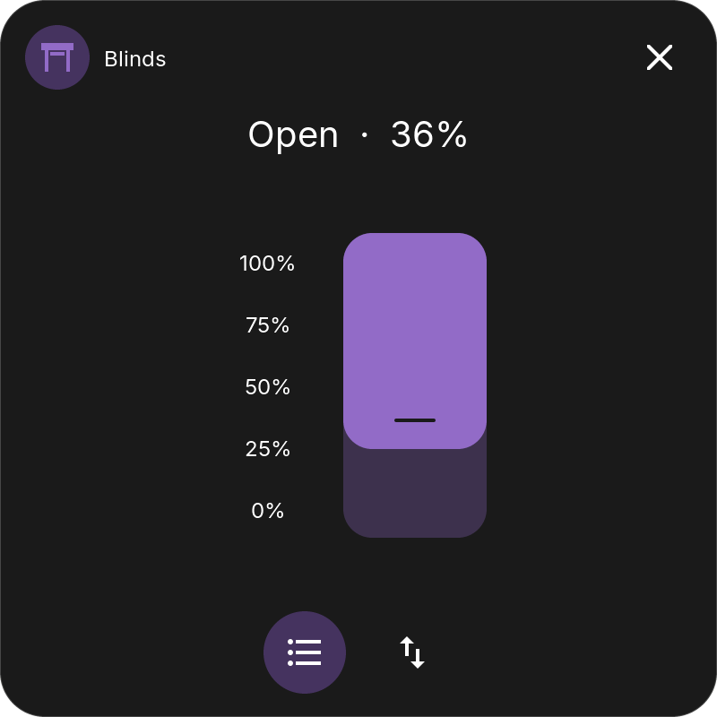
<figcaption>Popup</figcaption>
</figure>

The tile shows the position as a bar, like the Switch dimmer; half-height tiles show the state only. While the cover opens or closes, its arrow pulses.

**Popup:** separate position and tilt sliders, or open, close, and stop buttons. Controls depend on the cover's capabilities and availability. A slider sends its position once on release, like Home Assistant, and then follows the reported position.

### Button

Runs a scene, script or button with a tap; there is no popup. Its picker finds every scene, script and button through the Bridge, like the other tiles. Before v0.9.2 this tile was called Scene; existing tiles keep working.

<figure class="ht-screenshot">

<figcaption>Button</figcaption>
</figure>
<figure class="ht-screenshot">
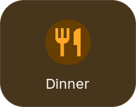
<figcaption>Button</figcaption>
</figure>
<figure class="ht-screenshot">
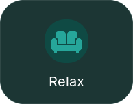
<figcaption>Button</figcaption>
</figure>

| Home Assistant domain | Tile action |
| --- | --- |
| `scene` | Activate the scene (`scene.turn_on`) |
| `script` | Start the script without additional fields (`script.turn_on`) |
| `button` | Press the button once (`button.press`) |
| `input_button` | Press the Button helper once (`input_button.press`) |

A never-pressed button remains usable even when HA reports an unknown timestamp. Missing or unavailable actions are ignored. Existing aliases remain stable when you reorder the selection or add entities with the same object name; custom aliases remain supported.

Use an HA script with defaults when an action needs parameters. Read-only `binary_sensor` and `event` entities cannot be pressed or switched. Locks, alarm panels, and fans have their own tiles; vacuums, valves, and update entities have different actions and are not mapped to these tile types; Cover, Climate, and Media keep their dedicated tiles.

### Weather

Shows current conditions and the next days from a `weather` entity. The number of days follows the tile's width.

<figure class="ht-screenshot">
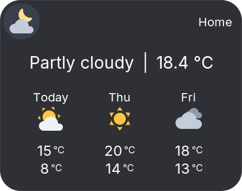
<figcaption>Tile</figcaption>
</figure>

<figure class="ht-screenshot ht-popup">
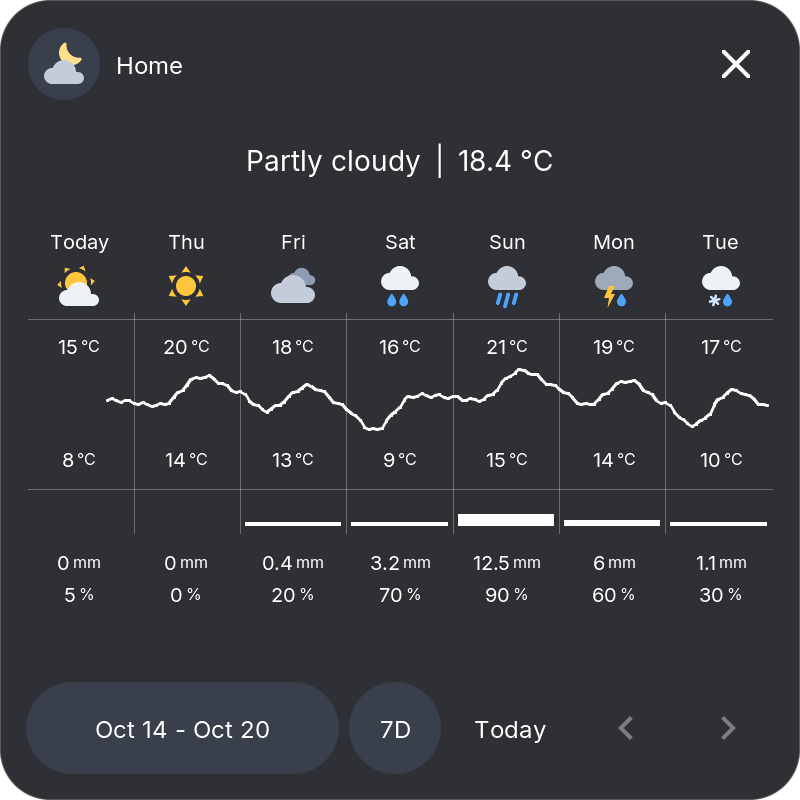
<figcaption>Popup, next days</figcaption>
</figure>

<figure class="ht-screenshot ht-popup">
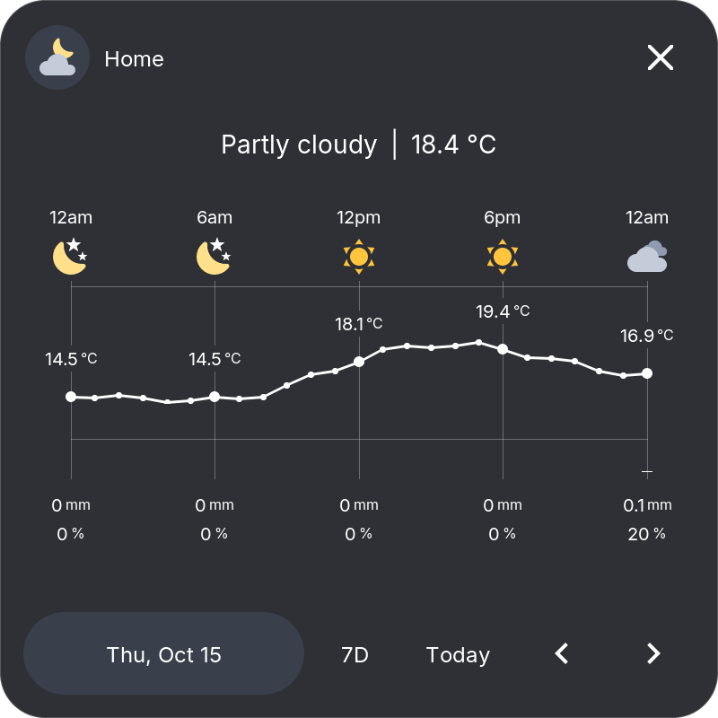
<figcaption>Popup, by hour</figcaption>
</figure>

**Popup:** temperatures, precipitation, and rain probability for the next days or by hour. Use the arrows to browse the available forecast.

**Icons:** weather icons are filled and colored (sun gold, clouds grey, rain blue, snow ice blue, thunderstorms purple, wind teal, night grey blue). Turn off **Colored weather icons** in the tile settings to keep the white outlines. With **Fill**, the tile takes the color of the current weather; an icon color you set yourself draws the whole icon in that color. When the Bridge sends sunrise and sunset, partly cloudy and clear hours after sunset show the moon.

**Own sensors:** choose a **Temperature sensor** to show your own outdoor sensor instead of the weather entity's current temperature, and a **Humidity sensor** to add its humidity, as in `21.5 °C · 64 %`. The tile and the popup header use them, in the weather entity's unit; the forecast still comes from the weather entity. A chosen sensor without a numeric state shows `--`.

### Media

Shows cover art, title, and playback controls for a `media_player` entity. Media tiles need at least 2×2 cells. With **From cover**, the icon and the tile take the color of the cover art. The icon shows whether the player plays, pauses or is off (for example `speaker-play`), and while a song plays or pauses, bars stand over its title and move while it plays.

<figure class="ht-screenshot">
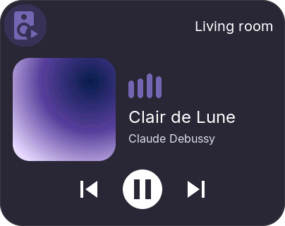
<figcaption>Tile</figcaption>
</figure>

<figure class="ht-screenshot ht-popup">
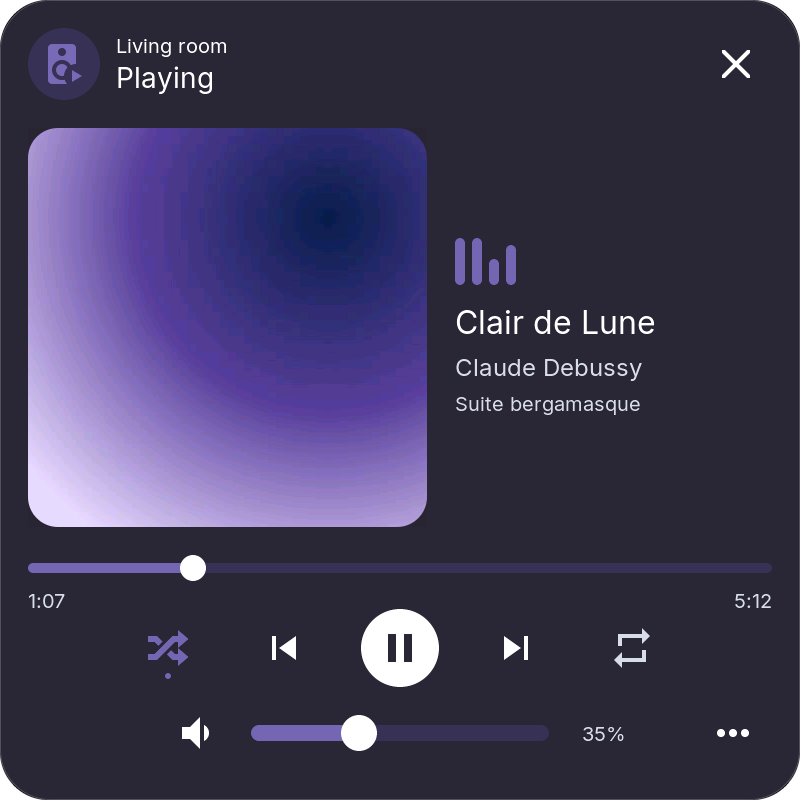
<figcaption>Popup</figcaption>
</figure>

**Popup:** cover art with title, artist and album, the time bar, playback controls and volume. **Popup** in the Web Admin chooses **Cover left** or **Cover centered**. The popup shows only the controls the player offers in Home Assistant; shuffle and repeat take the icon's color and a dot when they are on. The time follows the position Home Assistant reports.

The **⋯** button in the bottom right corner opens a menu with up to three lists, each where the player offers it:

- **Speakers:** play on several speakers together. The button shows how many play together.
- **Source:** the player's sources and sound modes.
- **Library:** browse Home Assistant's media for the player and start a title, album or playlist. The library keeps its place until the popup closes.

The menu and the library need HomeTiles Bridge v0.9.4 or newer.

<figure class="ht-screenshot ht-popup">
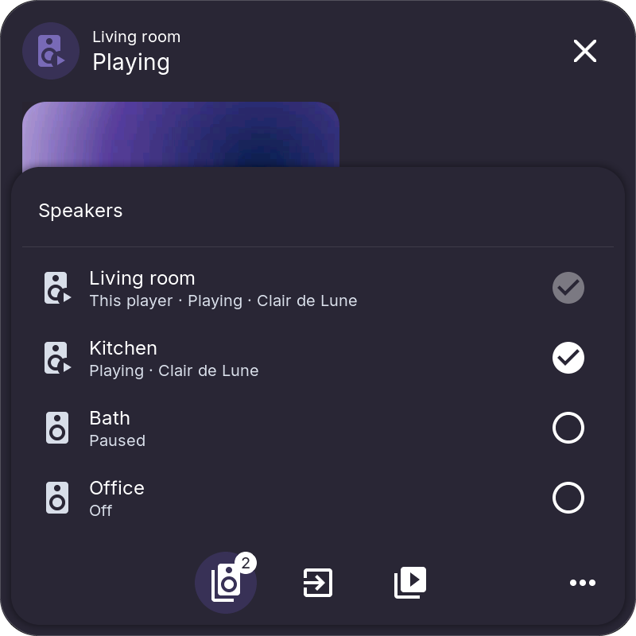
<figcaption>Speakers</figcaption>
</figure>
<figure class="ht-screenshot ht-popup">
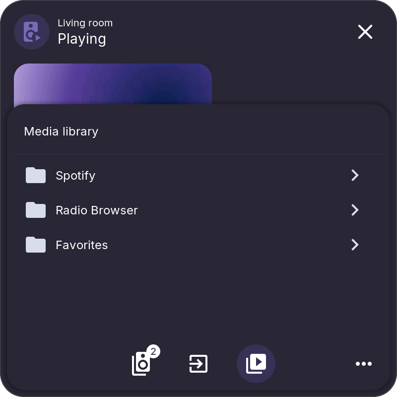
<figcaption>Library</figcaption>
</figure>

### Climate

Controls a `climate` entity. The icon and accent indicate active heating, cooling, drying, or fan operation.

Configure mini-tiles for temperatures, humidity, targets, and mode, or choose **Automatic**. Arrange them in the [Climate mini-tile editor](web-admin.md#editing-climate-mini-tiles). A small tile with only the target shows the mode and room temperature in its head and the target between **−** and **+**.

<figure class="ht-screenshot">
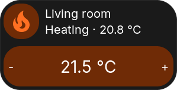
<figcaption>Heating</figcaption>
</figure>
<figure class="ht-screenshot">
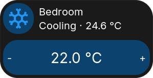
<figcaption>Cooling</figcaption>
</figure>

**Popup:** adjust the target with the dial or plus/minus buttons. Available controls may include heating/cooling targets, humidity, mode, presets, fan, and swing; longer option lists scroll.

<figure class="ht-screenshot ht-popup">
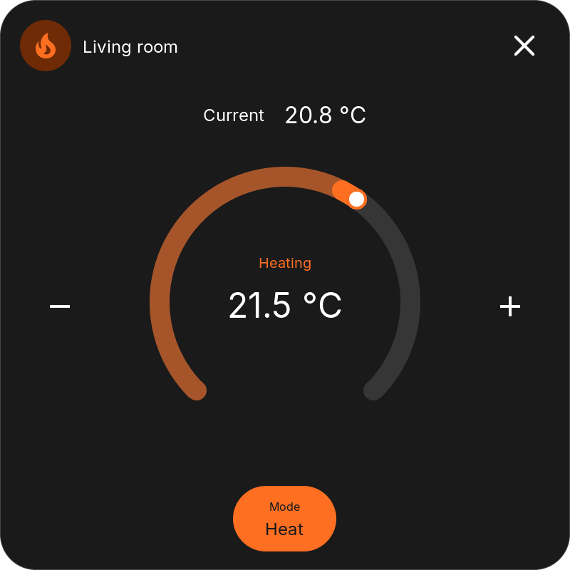
<figcaption>Popup</figcaption>
</figure>

### Fan

Controls a `fan` entity.

The tile shows the state and speed. Its bar sets the speed: stepless like the Switch dimmer, in segments for fans with only a few speeds, or as an on/off switch for fans without speed control. Tap or long press, whichever does not open the popup, switches the fan on or off.

<figure class="ht-screenshot">
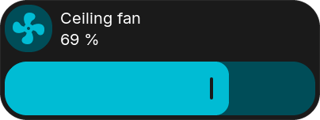
<figcaption>On</figcaption>
</figure>
<figure class="ht-screenshot">
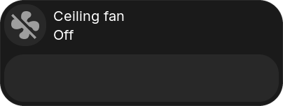
<figcaption>Off</figcaption>
</figure>

<figure class="ht-screenshot ht-popup">
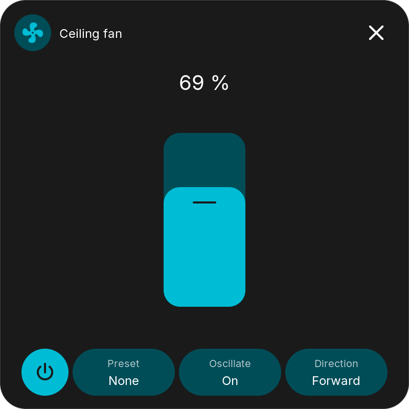
<figcaption>Popup</figcaption>
</figure>

**Popup:** the speed above a large slider, and below it the power button and, when the fan supports them, preset, oscillation, and direction. Only the controls the fan reports appear.

<figure class="ht-screenshot ht-popup">
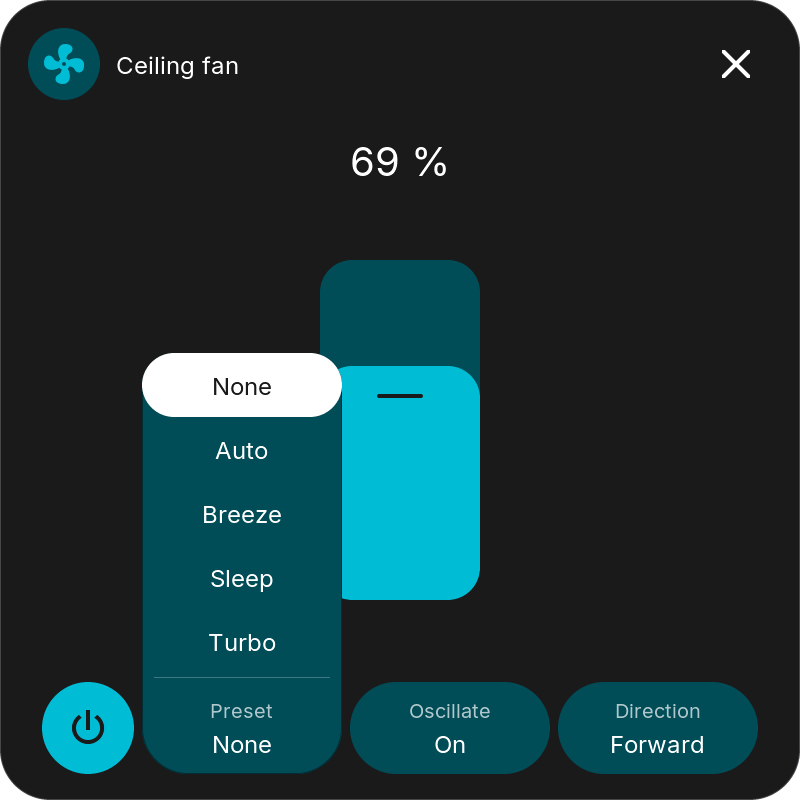
<figcaption>Presets</figcaption>
</figure>

### Lock

Controls a `lock` entity.

The tile shows the state in Home Assistant's colors: green while locked, red while unlocked, open, or jammed, orange while locking or unlocking. Its bar locks and unlocks; when the state is unknown or jammed it shows separate **Unlock** and **Lock** buttons.

<figure class="ht-screenshot">
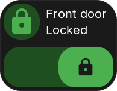
<figcaption>Locked</figcaption>
</figure>
<figure class="ht-screenshot">
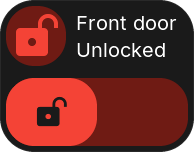
<figcaption>Unlocked</figcaption>
</figure>

<figure class="ht-screenshot ht-popup">
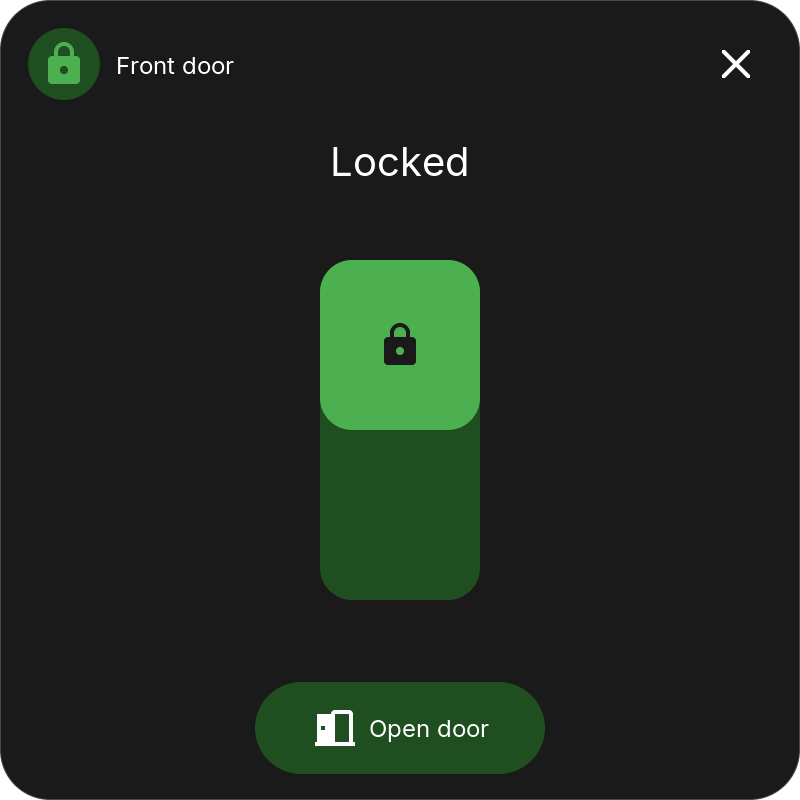
<figcaption>Popup</figcaption>
</figure>

**Popup:** a switch (up = locked) and, for locks that can open the door, **Open door** with a second tap to confirm. When Home Assistant needs a code, the code entry opens first.

<figure class="ht-screenshot ht-popup">
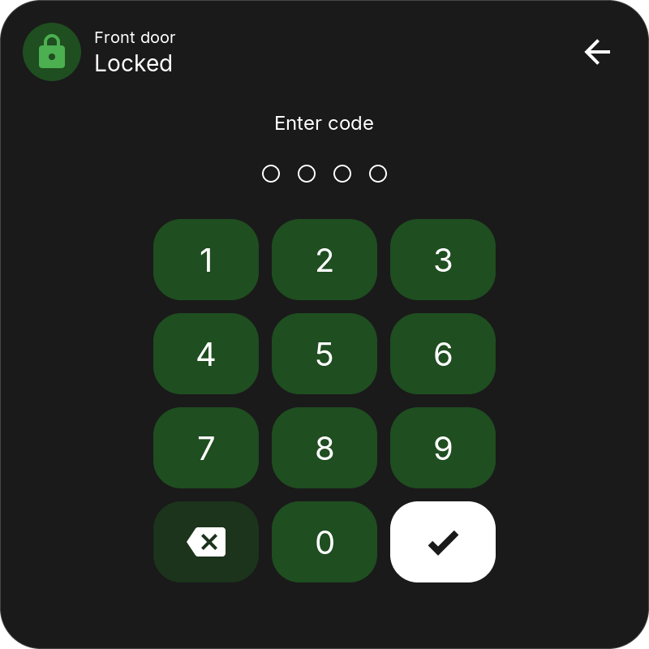
<figcaption>Code entry</figcaption>
</figure>

### Alarm Panel

Controls an `alarm_control_panel` entity.

The tile shows the state in Home Assistant's colors: green while armed, orange while arming, pending, or disarming, red when triggered, grey while disarmed. Its bar holds **Disarm** and the arming modes that fit.

<figure class="ht-screenshot">
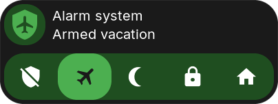
<figcaption>Armed</figcaption>
</figure>
<figure class="ht-screenshot">
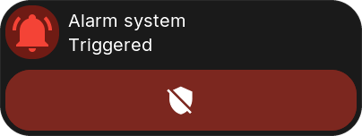
<figcaption>Triggered</figcaption>
</figure>

**Popup:** the modes the panel supports (**Home**, **Away**, **Night**, **Vacation**, **Custom**) and **Disarm**. While the panel arms, waits, disarms, or is triggered, only **Disarm** remains. When Home Assistant needs a code, the code entry opens first.

<figure class="ht-screenshot ht-popup">
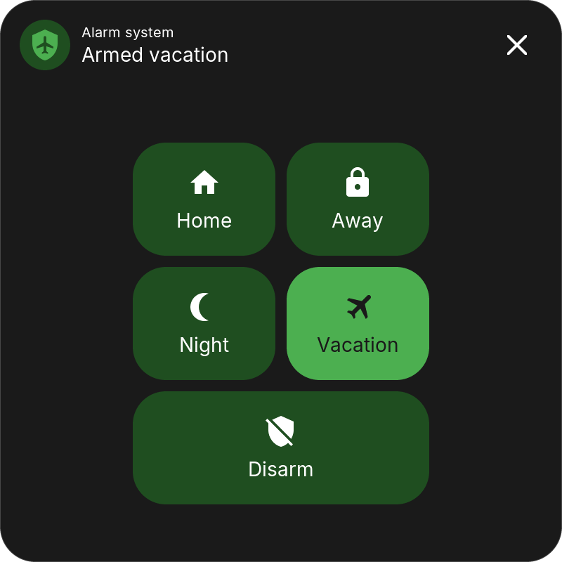
<figcaption>Popup</figcaption>
</figure>
<figure class="ht-screenshot ht-popup">

<figcaption>Code entry</figcaption>
</figure>
<figure class="ht-screenshot ht-popup">

<figcaption>Triggered</figcaption>
</figure>

**Lock and Alarm Panel security:** both run commands only on a [paired](bridge.md#encrypted-commands) display with a [Web Admin password](web-admin.md#web-admin-password); otherwise the tile and popup say what is missing. Home Assistant checks every code as in its own UI; unlocking, opening, and disarming always need the entity's code. A device without its own code can only be unlocked, opened, or disarmed when it is listed under **Allow opening without a code** in the Bridge options. For devices that ignore a wrong code, enter their codes under **Codes for locks and alarm panels** so the Bridge checks them; after five wrong codes, code entry is blocked for a while. Numeric codes are supported; devices that need a text code must be operated in Home Assistant.

Lock and Alarm Panel tiles show only states the device reports: a command waits with the icon pulsing, and the popup says so when the device does not answer. They are not available on the screensaver.

### Camera

Shows a `camera` or `image` entity. The camera can also be the [built-in camera](bridge.md#built-in-camera) of another HomeTiles display.

- **Show:** the icon, or the **Picture**: the tile shows the camera's current image in its own size, with the title in a pill. **Circle and title** can be **Automatic**, **Dark** or **Light**, with an adjustable transparency.
- **Tap opens:** the **Popup** with a 16:9 live video, or the **Full screen** video at once.

<figure class="ht-screenshot">

<figcaption>Tile with its picture</figcaption>
</figure>

<figure class="ht-screenshot ht-popup">

<figcaption>Popup with a live image</figcaption>
</figure>

ESP32-P4 displays play the video at up to 30 frames per second, in the popup and full screen; ESP32-S3 displays at about 4. Allow local TCP access to the Home Assistant host on ports `8124`–`8131`. See [Camera connection](bridge.md#experimental-camera-transport) for requirements and performance notes. A doorbell automation can open a camera full screen with the display's [View entity](bridge.md#control-the-displayed-view).

## Local Tiles

These types work without Home Assistant.

### Clock

Shows the time and date. Choose the style (**Digital**, **Analog** or **Wall clock**), the weekday, the date format, the alignment and rolling digits; the formats follow the display's localization unless you set them per tile. Tap a clock to open the [screensaver](screensaver.md).

<figure class="ht-screenshot">

<figcaption>Digital</figcaption>
</figure>
<figure class="ht-screenshot">

<figcaption>Analog, transparent</figcaption>
</figure>
<figure class="ht-screenshot">

<figcaption>Wall clock</figcaption>
</figure>

### Text

A label with a selectable font size, aligned left, centered or right and top, middle or bottom. It can be half a cell high and **Transparent**, for example as a heading above a group of tiles, as on the [Lights page](device-ui.md#head-bar-and-pages).

<figure class="ht-screenshot">

<figcaption>Text</figcaption>
</figure>

### Folder

Opens a sub-page with its own grid. In the head bar layouts its head has an **X** to go back; the classic layout adds a back tile. A folder on Home can also become a [page](web-admin.md#pages). See [Folders](web-admin.md#folders) for setup and optional PIN protection.

<figure class="ht-screenshot">

<figcaption>Folder</figcaption>
</figure>
<figure class="ht-screenshot">

<figcaption>Folder</figcaption>
</figure>
<figure class="ht-screenshot">

<figcaption>Protected folder</figcaption>
</figure>

A folder tile can follow an entity inside it: with [rules](web-admin.md#colors-and-rules) and **Entity color**, a Climate folder turns orange while heating and blue while cooling.

A protected folder asks for its PIN before it opens. The PIN pad takes the folder tile's color and shows the folder's name with the state **Locked**; below **Enter PIN**, one dot appears per typed digit. The PIN has 4 to 8 digits.

<figure class="ht-screenshot ht-popup">

<figcaption>PIN entry</figcaption>
</figure>

### Animation

Plays a `.panim` pixel animation from `/animations` on microSD. Configure frame rate, fit, and zoom.

### Empty

Leaves an empty cell for spacing.
