# Web Admin Panel

Open `http://<display-ip>/` in your computer's browser to edit your dashboard. The display shows the address in the last step of its setup and under **Settings → WiFi**; Home Assistant shows it on the display's device page.

<figure class="ht-screenshot">

<figcaption>Web Admin dashboard editor</figcaption>
</figure>

Select a tile in the preview to open its settings. Each folder has its own tab, and the preview shows the display's current layout.

!!! tip "Changes save automatically"
    Tile edits save as you make them and appear on the display.

## Creating a Tile

1. Click an empty cell.
2. Choose a **Type**.
3. Choose the entity where needed and adjust the tile.

The **entity picker** searches like Home Assistant: type part of a name, an area or a device. **Favorites** puts this display's entities on top (those its tiles use and those selected for it in the Bridge), **Recent** the ones you picked most in this browser, and **All** lists everything that fits the tile. A paired display with a [Web Admin password](#web-admin-password) finds every entity in Home Assistant; otherwise the picker offers the entities selected in the [Bridge options](bridge.md#entity-configuration). Picking an entity also takes its name and icon.

Every tile has these settings:

- **Title:** optional label; press **Enter** for a second line. Both lines are centered together, and each line ends in `...` if it exceeds the available width.
- **Icon (MDI):** a [Material Design Icon](https://pictogrammers.com/library/mdi/) name. **Show icon list** opens the catalog.
- **Color:** the **Icon color**, and **Fill** to fill the tile with it. Without your own color the icon keeps the color of its entity, for example a light's color. Clock, Text and Animation tiles have their own color instead.
- **Advanced:** options of the tile type, where it has any.
- **Column, Row, Width, Height:** position and size in half steps.

See [Tile Types](tiles.md) to choose the right type.

<figure class="ht-screenshot ht-editor-detail">
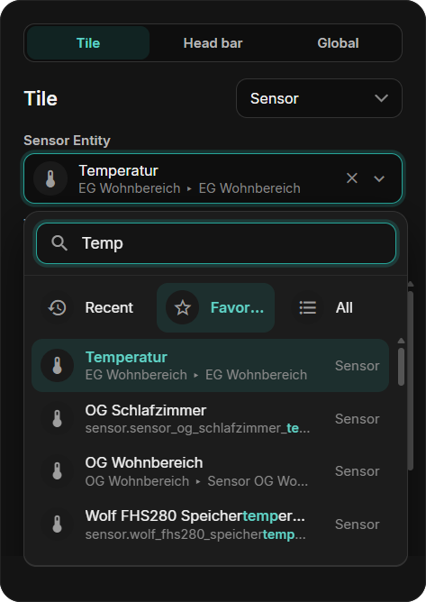
<figcaption>The entity picker</figcaption>
</figure>

### Type-specific settings { data-toc-label="Type settings" }

Fields depend on the selected type. A numeric Sensor offers:

| Field | Purpose |
| --- | --- |
| Entity | Sensor to display |
| Unit | Unit label, such as °C or W |
| Decimals | Decimal places |
| Value size | Size of the displayed value |
| Display mode | Text or a gauge with a minimum and maximum |

Number, Select, and Date/Time also offer **Value size** with the same choices as Sensor. In half-height tiles the value uses 20, 24, or 28. Choose the matching entity and whether a tap or long press opens its popup.

<figure class="ht-screenshot ht-editor-detail">
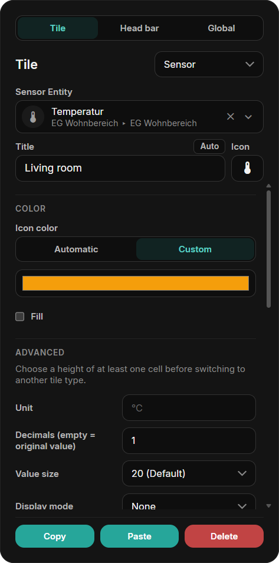
<figcaption>Sensor tile settings</figcaption>
</figure>

## Global Settings

The **Global** tab next to **Tile** applies to the whole display:

| Setting | What it does |
| --- | --- |
| **Tile borders** | Draws a thin line around the tiles. Clock and Text tiles can switch it off individually. |
| **Layout** | Shows the active layout and its grid; a click opens the [layout window](#layouts). |
| **Theme** | **Dark**, **Light** or **Automatic** (light by day, dark at night), for the display and the Web Admin. |
| **Edge swipes** | One action per screen edge: **Settings**, **Home**, **Back**, or the **screensaver**. New displays open Settings from the top and go Home from the bottom. |

Corners, circles and the tile cards follow the theme; there is no separate radius or tile color setting.

<figure class="ht-screenshot ht-editor-detail">
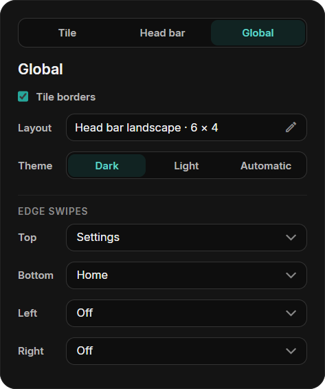
<figcaption>The Global tab</figcaption>
</figure>

## Head Bar

In the head bar layouts the **Head bar** tab, between **Tile** and **Global**, sets Home's head:

- **Home title** and icon: **Auto** shows "Home" in the display's language and the house.
- **Gear for Settings**, **Clock**, and **Page overview** on the dots. Without the overview, the dots only show the page.

<figure class="ht-screenshot ht-editor-detail">
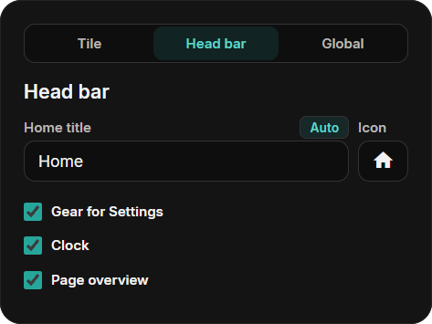
<figcaption>The Head bar tab</figcaption>
</figure>

## Layouts

Every display keeps its tiles in three layouts: **Classic**, **Head bar landscape** and **Head bar portrait** (portrait only on ESP32-P4 displays that can stand upright). A click on the **Layout** field in the **Global** tab opens the layout window (**Change layout**):

- The screen is at the top left, the **Storage** to the right and below it. Drag tiles between them; a tile in the storage is not shown in that layout but keeps its settings.
- Each folder has room for its storage on top of its grid cells, so tiles in the storage never take the place a new tile on a free cell needs. When a layout's storage holds more tiles than it has room for, **Save** waits until you place or delete some.
- A folder that is completely full still shows the frame on a free cell; a click on it tells you so. Clear out the storage here and save.
- Each layout has its own tab and places. **Copy from …** takes the places of another layout as a start.
- A red tile has no place yet. While a folder or the Settings tile is red, **Save** and **Switch** wait: every folder must stay reachable.
- **X** on a tile deletes it from every layout, after a question.
- **Switch** restarts the display in the chosen layout. Its places stay saved when you switch back.
- The **Screensaver** tab places the screensaver's tiles and clock for this layout.

Places are saved with **Save**; nothing changes on the display before that.

<figure class="ht-screenshot">
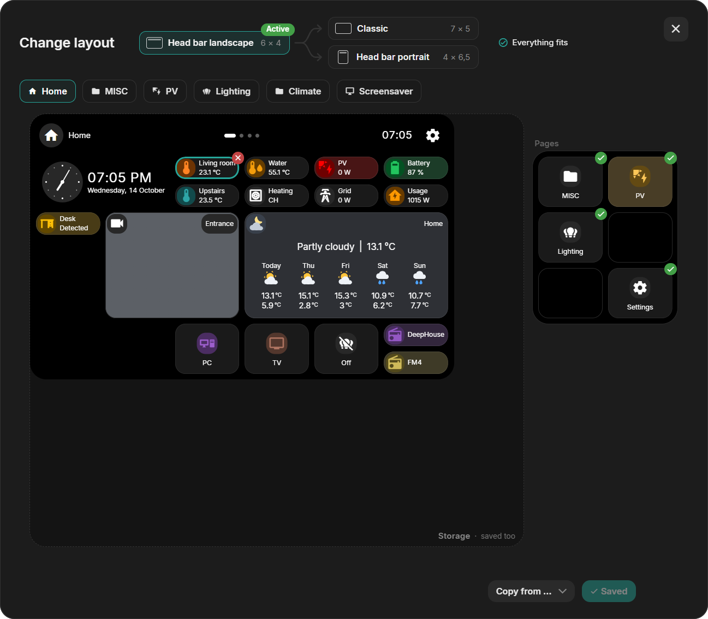
<figcaption>The layout window</figcaption>
</figure>

<figure class="ht-screenshot">
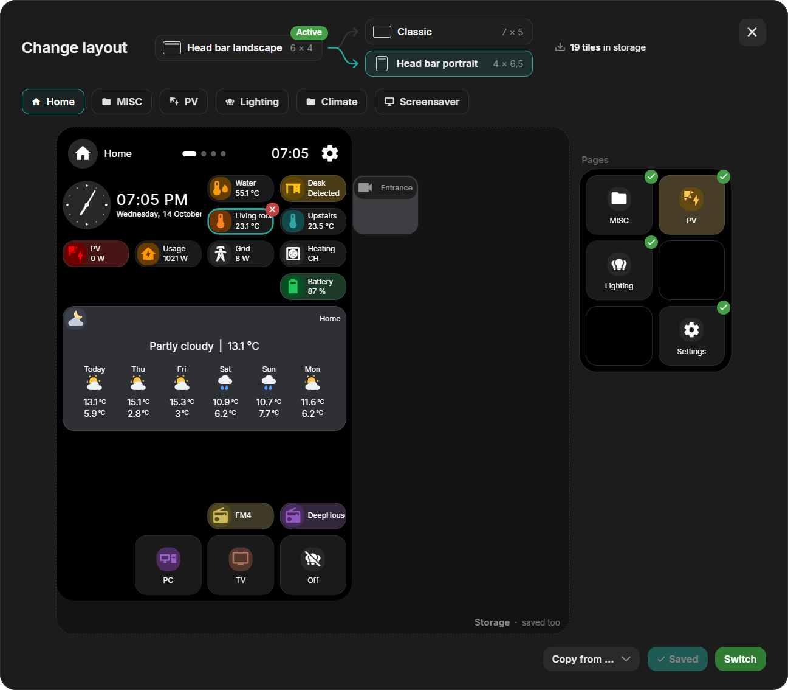
<figcaption>The same tiles placed for the upright layout</figcaption>
</figure>

## Pages

In the head bar layouts, Home has five page fields beside or below its grid. Drag a folder tile from Home into a field: the folder becomes a page and its tile leaves Home. Drag it out again to make it a tile. A new folder can go straight into a free field. Pages have no PIN: a protected folder asks before its PIN is removed.

On the display, the [page dots](device-ui.md#head-bar-and-pages) show the pages in the order of the fields.

<figure class="ht-screenshot">
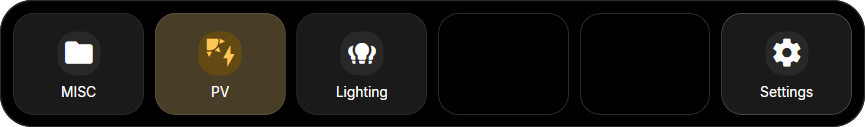
<figcaption>Three folders as pages, and the Settings field</figcaption>
</figure>

## Colors and Rules { data-toc-label="Colors and rules" }

A tile's color comes from its icon. Rules change the icon color while an entity has a matching state. Set **Rules** to **On** in the tile settings; a tile with its own entity starts at **Own entity** and **Own rules**:

- **Own entity / Other entity:** follow the tile's own entity or any other entity. Button, Folder, Camera, Clock, and Text tiles have no entity of their own and always use another entity.
- **Entity color:** use the color the entity shows itself: a light's color, heating or cooling on a climate entity, and the state colors of switches, covers, and binary sensors.
- **Own rules:** choose the colors yourself, by value or by state (see below).

While a rule matches, it wins. Otherwise the settings above apply. Without a state, for example while Home Assistant is offline, the tile keeps its icon color.

### Icon Color by Value { data-toc-label="By value" }

For Sensor, Energy, and Number tiles: a color bar between **Min** and **Max**. **Smooth** blends the colors, **Steps** changes at each marker. Start from **Cold → Warm**, **Traffic light**, **Battery**, **Humidity**, or **Single color**. Drag a marker to move it, click it to choose its color, and double-click the bar to add one (up to six). The tile's **Fill** fills it in the current color.

<figure class="ht-screenshot">
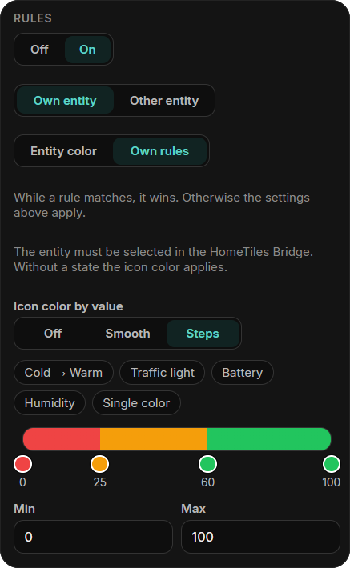
<figcaption>A battery from red to green</figcaption>
</figure>

### Icon Color by State { data-toc-label="By state" }

For Sensor, Binary Sensor, Select, and Date/Time tiles: up to six states, each with a color. A row matches the exact state, or any state containing its text when **contains** is ticked; upper and lower case do not matter, and the first match wins. Binary sensors have one color for On and one for Off. Unavailable states keep the default color.

Each row has its own **Fill**: the tile is filled only while that row matches, and stays a plain card otherwise. In this example, a waste sensor says when to put the bin out. Its row for "Today" colors the icon orange and fills the tile, so only the bin that goes out today stands out.

<figure class="ht-screenshot">
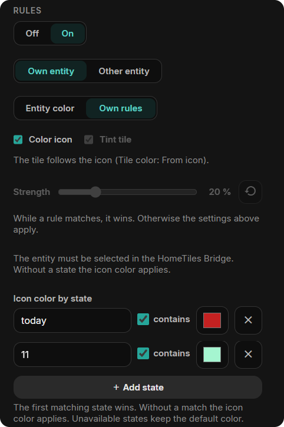
<figcaption>State rules</figcaption>
</figure>
<figure class="ht-screenshot">

<figcaption>"Today": filled</figcaption>
</figure>

## Editing Climate Mini-Tiles { data-toc-label="Climate mini-tiles" }

Click a Climate mini-tile in the preview to edit it, or drag it to another slot. The outline shows whether you are selecting the parent tile or a mini-tile.

Choose temperature, humidity, targets, or mode. **Automatic** chooses values supported by the entity. **Target** is the single target temperature; **Heating target** and **Cooling target** are the two limits of devices that keep a range in Heat/Cool mode.

Resizing the parent changes the available slots. Mini-tiles that still fit keep their place; only those without room are hidden until the tile grows again.

<figure class="ht-screenshot">
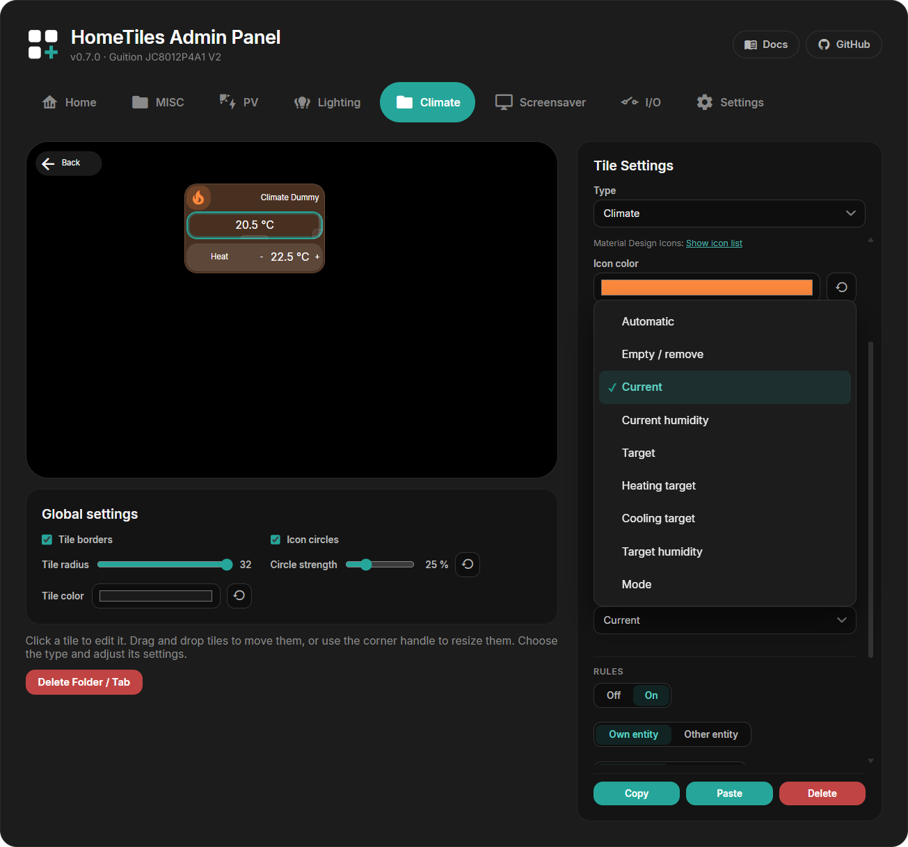
<figcaption>Climate tile and mini-tile editor</figcaption>
</figure>

## Moving, Resizing, Copying { data-toc-label="Move, resize, copy" }

- **Move:** drag a tile to another cell.
- **Resize:** drag its edge handles or enter **Width / Height**. Sizes change in half steps; almost every tile can also be half a cell high.
- **Copy / Paste:** duplicate a tile, including between folders. Paste onto an empty cell where the copied size fits.
- **Delete:** clear a tile back to an empty cell.

## Folders

Choose the **Folder** type to create a sub-page. It appears as a Web Admin tab. In the head bar layouts its head has an **X** to go back; the classic layout adds a back tile. A folder that still contains tiles keeps its type until you empty it.

**Delete Folder / Tab** removes the folder and its tiles.

To protect a folder, select its tile, enable **Protect this folder with a PIN**, enter 4–8 digits, and press **Apply PIN**. The display then asks for the PIN before opening the folder. Folder PINs are stored only on that display and are excluded from exports.

A folder tile can also show the state of what is inside: with **Rules → On**, the climate entity and **Entity color**, a **Climate** folder turns orange while heating and blue while cooling.

In the classic layout, select the back tile to change its icon and color. It can be moved like any tile and made half a cell high.

## Settings Tile and Access { data-toc-label="Settings access" }

Settings opens from the gear in the head, from the Settings tile, or by an [edge swipe](#global-settings). In the [layout window](#layouts), the Settings tile has its own field: a tile parked there is not shown in that layout. Each layout keeps its own choice.

Select the Settings tile to set:

- **PIN protection:** ask for a 4–8 digit PIN before Settings opens.
- **Hide tile:** park the tile in the layout the display shows.
- **Gear in the head:** the same as **Gear for Settings** in the [Head bar](#head-bar) tab.

The public factory PIN **466384537** unlocks Settings and protected folders. This is a local child lock, not a login; protect the Web Admin itself with a [Web Admin password](#web-admin-password). PINs are excluded from dashboard exports.

## Screensaver Editor

Open the **Screensaver** tab. Select the background, clock, or a tile to edit it; drag to move and resize.

See the [Screensaver guide](screensaver.md) for images, activation, and available tiles. Its **Tile borders** setting is independent of the global **Tile borders** for the normal dashboard.

## Device Settings

**Settings** lists the same pages as the display:

- **WiFi:** WiFi credentials, connection type on Ethernet-capable devices, and an optional static IP shared by WiFi and Ethernet.
- **Localization:** language, time zone, and date/time formats.
- **System:** firmware update, the [icon file](#icons), the connection to Home Assistant, pairing, and the [Web Admin password](#web-admin-password). The **MQTT** settings are folded in here; while the direct link is active they stay saved but unused.
- **I/O:** [local hardware](hardware-io.md).
- **Built-in camera:** on displays with a camera, see below.
- **Files** and **Diagnostics:** see below.

<figure class="ht-screenshot">
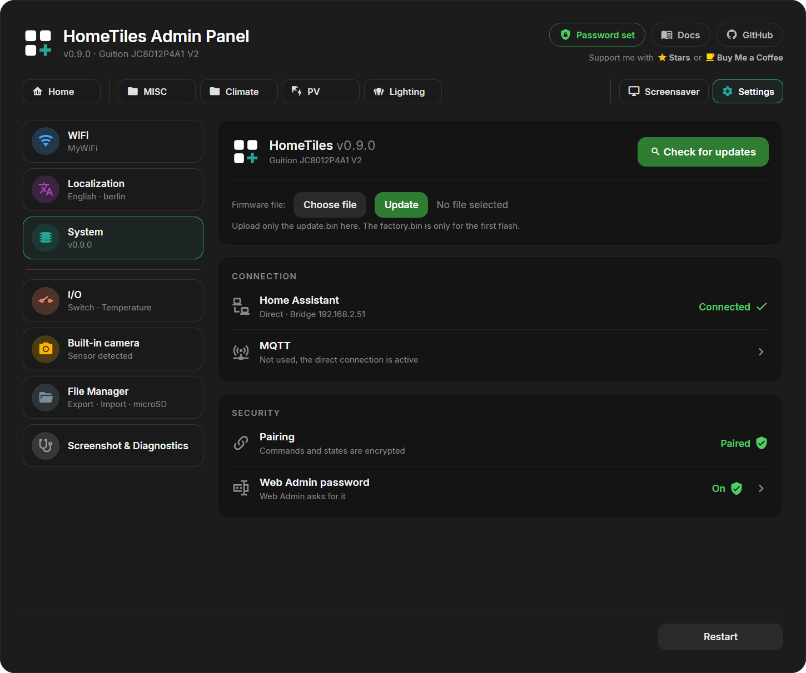
<figcaption>Device settings in the Web Admin</figcaption>
</figure>

### Icons

All 7447 Material Design Icons live in an icon file in the display's internal storage; 399 common icons, including Home Assistant's default icons, are built into the firmware. Without a valid icon file the display shows the built-in icons and a placeholder for the others.

A display without the file downloads it from the GitHub release of its own firmware version and restarts. If that fails, it tries again on the next restarts, up to three times per firmware version. Displays flashed with a factory image already have the file.

The **Icons** card below the firmware update shows the file:

- **Present:** the file name, the number of icons and a check mark.
- **Missing or not usable:** a download link to the right file for this display and firmware version (`hometiles-icons-<size>.bin`), the built-in and total icon count (for example 399 / 7447), and in red why the last download or install failed. **Update** makes the display download the file now, also after three failed attempts.

If the display cannot reach GitHub, for example behind a firewall, download the file with the link on your computer, select it under **Icon file** with **Choose file**, and press **Update**. The display checks the file before it installs it and refuses one that does not match its firmware's icons, such as a file for another icon size.

The screen stays dark while the display downloads the file or installs an uploaded one. It restarts afterwards, also after a failure, and the page reloads when it answers again.

### Web Admin Password { data-toc-label="Password" }

The Web Admin is open to everyone on your network by default. A password protects every page and API request, including the settings, restart, firmware upload, the file manager, and screenshots. On a paired display it also lets the entity picker find every Home Assistant entity, and [locks and alarm panels](tiles.md#lock) need it.

1. On the display, open **Settings → System → Security** and tap **Allow** next to **Web Admin password**.
2. Within two minutes, enter the new password twice under **Settings → System** and select **Set password**.

Only someone at the display can set the first password.

- The password is never sent in plain text: the browser proves it with a one-time challenge, and the display stores only a derived key.
- Wrong passwords lock the sign-in for an increasing time, up to five minutes.
- You stay signed in for 30 days, also after a restart or update of the display. **Sign out** ends the browser session; **Remove password** opens the Web Admin to the network again.
- Forgot the password? On the display, open **Settings → System → Security** and remove it.

<figure class="ht-screenshot">
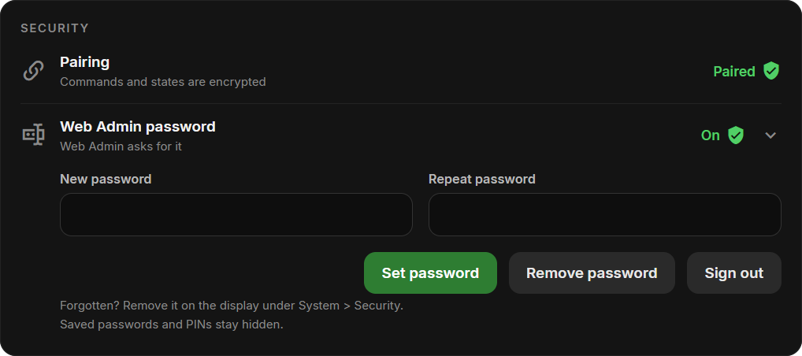
<figcaption>Web Admin password</figcaption>
</figure>

<figure class="ht-screenshot">
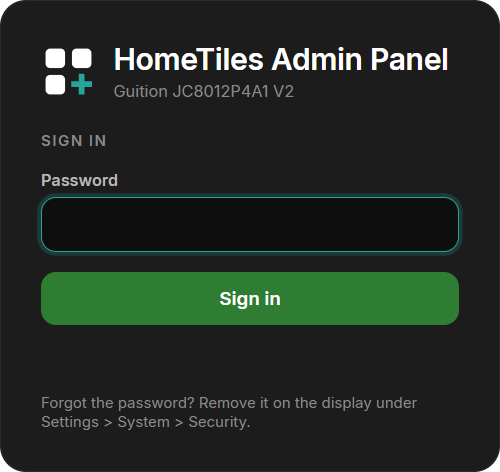
<figcaption>Sign-in page</figcaption>
</figure>

### Built-in Camera

Displays with a supported camera show this section. **Allow Home Assistant to use the built-in camera** is off by default. When enabled, the display captures still images or a live stream only while the [HomeTiles Bridge](bridge.md#built-in-camera) requests them.

<figure class="ht-screenshot">
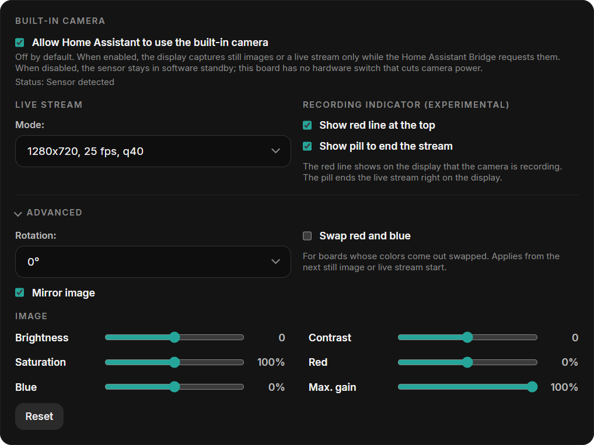
<figcaption>Built-in camera settings</figcaption>
</figure>

- **Mode:** resolution, frame rate, and JPEG quality of the live stream. Higher values need more bandwidth.
- **Recording indicator:** a red line at the top of the display and a circle in the head (a pill in the classic layout) to end the stream while the camera is in use.
- **Advanced:** rotation, mirroring, and a red/blue swap for boards whose colors come out swapped.
- **Image:** brightness, contrast, saturation, red and blue balance, and the maximum gain for dark rooms. **Reset** restores the defaults.

## Local Hardware I/O

Open **I/O** to configure outputs, relays, or DS18B20 sensors. Only pins available for the selected device are offered. See [Local Hardware I/O](hardware-io.md) for setup and wiring.

## Import / Export

**Export** saves folders, tiles, the places of every layout, the pages and the screensaver in one JSON file. It excludes local I/O assignments and PINs. Older files without layouts or screensaver data leave those unchanged.

<figure class="ht-screenshot">
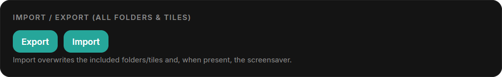
<figcaption>Import and export settings</figcaption>
</figure>

!!! warning
    Import replaces the folders, tiles, and screensaver data contained in the file.

## Screenshot & Diagnostics { data-toc-label="Diagnostics" }

<figure class="ht-screenshot">
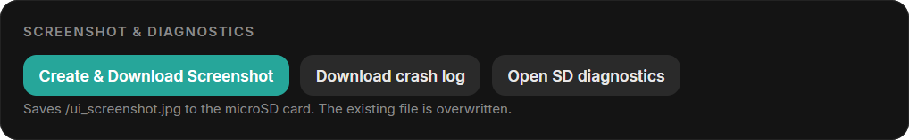
<figcaption>Screenshot and diagnostics</figcaption>
</figure>

- **Create & Download Screenshot:** saves and downloads a JPEG of the current screen; requires microSD.
- **Download crash log:** downloads reset reasons and crash details.
- **Open SD diagnostics:** runs a short write and read test on the microSD card and shows the report.
- **Core dump:** download or delete a stored memory snapshot when one is available.

See [Reporting a crash](faq.md#the-display-crashed-or-restarted-by-itself) for the files and details to include.

## Firmware Update

Check for releases or upload the matching OTA `.bin` under **Settings → System**. Follow [Firmware Updates](updating.md) for the steps.

<figure class="ht-screenshot">

<figcaption>Firmware update</figcaption>
</figure>

## File Manager

With a FAT32 microSD card inserted, use the file manager to upload, download, rename, or delete files and create folders. A card is optional for normal dashboard use.

<figure class="ht-screenshot">
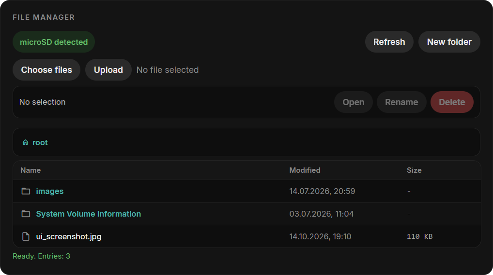
<figcaption>microSD file manager</figcaption>
</figure>
